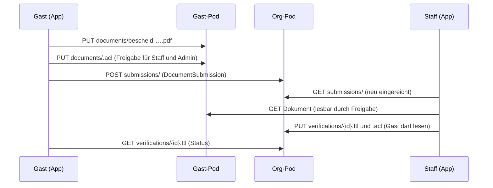
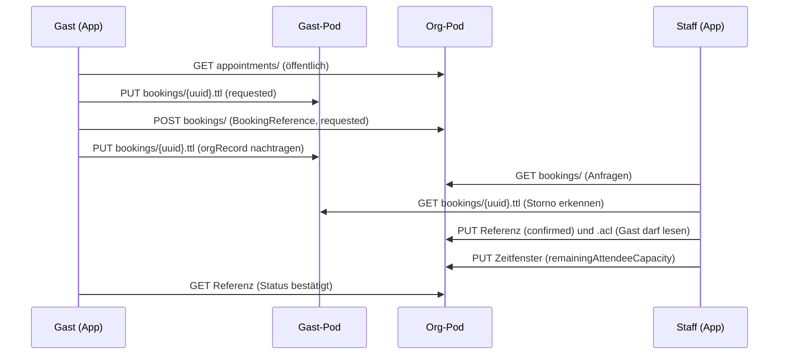

# Pflichtenheft — Tafel-Kalender-App „solid-tafel“

| | |
|---|---|
| **Dokumentversion** | 1.1 — Entwurf nach Gegenprüfung (Änderungen gegenüber 1.0: Anhang C) |
| **Bezugsstand** | App v0.0.9 (live) · Vokabular `ns.ttl` v0.3 · `pod-layout.md` (v0.0.9) |
| **Zielstand** | MVP für **einen** Standort (Tafel Herford) |
| **Autor** | Pal (meisdata / ewingson), erarbeitet mit Claude |
| **Sprache** | Text auf Deutsch; Dateinamen, Klassen und Properties wie im Code auf Englisch |
| **Ablageort im Repo** | `doc/pflichtenheft.md` |

## Lesehinweise (für Einsteiger)

- **Priorität:** **M** = Muss (ohne geht das MVP nicht) · **S** = Soll (wichtig, blockiert das MVP aber nicht) · **K** = Kann (später).
- **IDs:** `AF-` Architekturfestlegung · `FA-` funktionale Anforderung · `NFA-` nichtfunktionale Anforderung · `D-` offene Entscheidung · `R-` Risiko · `T-` Aufgabe (To-do) · `S-` Sicherheitstest.
- **Lernhinweis** markiert Stellen, an denen Solid-Einsteiger erfahrungsgemäß stolpern.
- **`{POD}`** steht für die Wurzel-URL eines Pods **mit** abschließendem `/`, z. B. `https://teamid.live/herford/`. Eine Adresse wird also als `{POD}solid-tafel/bookings/` geschrieben.
- **Zeitangaben fehlen absichtlich.** Die Reihenfolge der Meilensteine ist verbindlich, Zeitpläne nicht.
- Alles, was in früheren Gesprächen bereits entschieden wurde, steht als **Festlegung** da. Alles, was noch offen ist, steht im **Entscheidungsprotokoll (Abschnitt 14)** mit einer Empfehlung.

---

## 1. Zielbestimmung

### 1.1 Ziel

Eine schlichte Web-App, mit der die **Tafel Herford**

1. **Zeitfenster für Abholungen** anbietet,
2. **Gäste (Endverbraucher)** ein Zeitfenster **buchen** können,
3. Gäste ihren **Bescheid als PDF** hochladen können,
4. **Mitarbeitende (Staff)** Buchungen bestätigen und dem Bescheid einen **Status** geben (`verified` / `pending` / `rejected` / `expired`).

Alle personenbezogenen Daten bleiben in **Solid Pods**. Es gibt keine eigene Server-Software, nur statische Dateien (HTML/JS/CSS) bei serverproject.de.

### 1.2 Muss-Kriterien (Kurzfassung)

- [ ] Ein (1) Org-Pod (Herford); Konfiguration so, dass später weitere Org-Pods möglich sind.
- [ ] Rollen: **Gast**, **Staff**, **Admin**; Rolle wird aus dem Org-Pod ermittelt, nie selbst behauptet.
- [ ] Staff legt Zeitfenster an, ändert sie und sagt sie ab.
- [ ] Gast sieht Zeitfenster und kann innerhalb eines Zeitfensters buchen (Status: `requested` → `confirmed` / `cancelled`).
- [ ] Gast lädt einen Bescheid als PDF in den eigenen Pod hoch.
- [ ] Staff prüft den Bescheid und setzt den Status (`verified` / `pending` / `rejected` / `expired`).
- [ ] Gast sieht Status von Buchung und Bescheid.
- [ ] UI schlicht, deutsch, auf dem Handy bedienbar.

### 1.3 Nicht-Ziele (bewusst nicht im MVP)

- Zweiter Standort (Bielefeld) und Standortauswahl
- Oberfläche zur Pflege der Staff-Listen (Pflege erfolgt manuell, siehe FA-R4)
- E-Mail/Push-Benachrichtigungen, automatische Erinnerungen
- Server-seitige Logik (Cron-Jobs, Webhooks)
- Kalender-Widget (es gibt eine schlichte Liste)
- Automatisches Anlegen von Pods für Gäste
- Statistiken und Berichte
- Mehrsprachigkeit (nur Deutsch)
- Offline-Betrieb

### 1.4 Einschätzung zu „CRUD ist kein größeres Problem“

Ehrlich gesagt: **Ja, aber nur zur Hälfte.** Das reine Lesen, Anlegen, Ändern und Löschen von Ressourcen ist in Solid einfach (`GET`, `PUT`, `POST`, `DELETE` mit der vorhandenen authentifizierten `fetch`-Funktion). Schwierig sind drei andere Dinge, und der Plan ist um sie herum gebaut:

1. **Berechtigungen über Pod-Grenzen hinweg.** Wer darf in wessen Pod lesen, und wer darf die Zugriffsregeln (`.acl`) schreiben?
2. **Konsistenz ohne Transaktionen.** Solid hat keine „zähle atomar herunter“-Operation. Die Kapazität eines Zeitfensters kann deshalb nicht von zwei Gästen gleichzeitig sicher verbraucht werden. Lösung: Staff bestätigt Buchungen (Abschnitt 5.2 und FA-B5).
3. **Datenschutz und Onboarding.** Ein Bescheid ist sensibel, und Gäste müssen erst einmal einen Pod haben (Risiko R-01).

---

## 2. Ausgangslage

### 2.1 Was bereits vorhanden ist (v0.0.9, live)

| Vorhanden | Anmerkung |
|---|---|
| Solid-OIDC-Login/-Logout | `@inrupt/solid-client-authn-browser` 4.0.0 |
| Profil lesen und parsen | `N3` 2.0.3, 7 Debug-Parameter |
| Sitzung wiederherstellen | über die Inrupt-Bibliothek, `localStorage` nur als Hinweis |
| „Get a Pod“-Link | Startseite für Gäste |
| Regressionstests | 14 jsdom-Szenarien gegen die echten Bibliotheken |
| Vokabular `ns.ttl` | `https://serverproject.de/solid-tafel/ns.ttl#`, liefert `text/turtle` aus |
| Pod-Konzept | `doc/pod-layout.md` (mit Korrekturbedarf, siehe Anhang B) |

Die App **schreibt noch nichts**. Es gibt bisher keinen Schreibpfad.

### 2.2 Annahmen

| ID | Annahme |
|---|---|
| A-1 | Der Org-Pod Herford liegt auf einer Community Solid Server-Instanz (CSS); URL und WebID sind festgelegt (Abschnitt 2.3). |
| A-2 | Gäste haben einen Pod bei einem beliebigen Anbieter (z. B. solidweb.org, teamid.live). Die App stellt keinen Pod bereit. |
| A-3 | Staff und Admin haben WebIDs, die von Pal in die Gruppendokumente eingetragen werden. |
| A-4 | Der Org-Pod ist so konfiguriert, dass fremde Identitätsanbieter (andere Issuer) akzeptiert werden. Das ist zu testen (T-0.9). |
| A-5 | Pro Zeitfenster sind höchstens etwa 100 Buchungen zu erwarten. |
| A-6 | Der Org-Pod und der erste Test-Gast liegen auf **demselben Server** (teamid.live). Das genügt für die Entwicklung, beweist aber **nicht**, dass Zugriffe über Servergrenzen hinweg funktionieren (siehe R-02, R-12, T-0.3). |

### 2.3 Festgelegte Konten

| Zweck | Pod | WebID |
|---|---|---|
| **Org-Pod = Admin-Pod** (Herford) | `https://teamid.live/herford/` | `https://teamid.live/herford/profile/card#me` |
| **Test-Gast** | `https://teamid.live/tafel_test/` | `https://teamid.live/tafel_test/profile/card#me` |

Weitere Testkonten stehen in T-0.3. Der Pod `tafel_test` war zeitweise als Ablageort des Namensraums vorgesehen; der Namensraum liegt jetzt endgültig bei `https://serverproject.de/solid-tafel/ns.ttl#`. Falls unter `tafel_test` noch Reste davon liegen (`ns`, `ns.acl`), werden sie entfernt (T-0.12).

---

## 3. Rollen

### 3.1 Ein Pod-Typ, mehrere Rollen

Alle Pods sind **architektonisch gleich**: normale Solid-Pods mit WebID, Speicher und Zugriffsregeln (AF-02). Es gibt keinen „Spezial-Pod“ für die Tafel.

- Der **Org-Pod ist zugleich der Admin-Pod.** Er gehört der Organisation (WebID `https://teamid.live/herford/profile/card#me`). Wer diese WebID besitzt, ist Eigentümer und damit Admin.
- Ein **Staff-Pod** ist der ganz normale Pod einer mitarbeitenden Person. Die Mitarbeiterrolle entsteht **nicht** durch den Pod, sondern dadurch, dass ihre WebID in der Staff-Liste des Org-Pods steht.
- Ein **Gast-Pod** ist der ganz normale Pod eines Gastes.
- Eine **Rolle ist eine Beziehung** einer WebID zur Organisation, keine Eigenschaft eines Pods. Dieselbe Person kann in einem anderen Zusammenhang Gast sein.

### 3.2 Rollentabelle

| Rolle | Wie erkannt | Darf | Darf nicht |
|---|---|---|---|
| **Besucher** (nicht eingeloggt) | keine Sitzung | Login starten, „Get a Pod“, Datenschutzhinweis lesen; optional Zeitfenster ansehen (FA-Z6, K) | alles andere |
| **Gast** (Endverbraucher, `consumer`) | eingeloggt, WebID in keiner Gruppe | Zeitfenster ansehen; Buchung anfragen und stornieren; PDF hochladen, ansehen, löschen; Freigabe erteilen und widerrufen; eigene Status sehen | Zeitfenster ändern; fremde Daten lesen; Status setzen |
| **Staff** (Mitarbeitende) | WebID steht in `staff/herford.ttl` | alles, was ein Gast darf, plus: Zeitfenster anlegen, ändern, absagen; Anfragen bestätigen oder ablehnen; Tagesliste; eingereichte Bescheide ansehen (nur bei Freigabe) und Status setzen | Staff-Listen ändern |
| **Admin** | WebID ist die des Org-Pods (`ORG_WEBID`, automatisch) **oder** steht in `staff/admins.ttl` | alles, was Staff darf, plus Aufräumen abgelaufener Daten (FA-V6); Staff- und Admin-Listen im MVP ohne Oberfläche, Pflege manuell (FA-R4) | – |

> **Lernhinweis (wichtig):** Die App **versteckt** Funktionen je nach Rolle. Das ist nur Bequemlichkeit. **Die eigentliche Sicherheit sind die Zugriffsregeln (ACL) der Pods.** Jemand, der die Entwicklerkonsole öffnet, kann die Oberfläche umgehen, aber nicht die ACL. Deshalb gilt jede Berechtigungsanforderung in diesem Dokument zweimal: einmal in der Oberfläche, einmal in der ACL.

---

## 4. Architekturfestlegungen (aus den bisherigen Entscheidungen)

| ID | Festlegung |
|---|---|
| AF-01 | Reine Client-App (HTML + JavaScript), statisch bei serverproject.de ausgeliefert. Keine eigene Server-Logik. |
| AF-02 | **Alle Pods haben dieselbe Architektur** (Org-/Admin-Pod, Staff-Pods, Gast-Pods): normale Solid-Pods; alle App-Daten liegen im Container `{POD}solid-tafel/` mit **demselben Satz an Unter-Containern** (6.1). Unterschiede entstehen nur durch **ACL, Dateninhalt und Rolle**, nie durch ein anderes Schema. |
| AF-03 | **Ein** Org-Pod im MVP: `https://teamid.live/herford/` mit WebID `https://teamid.live/herford/profile/card#me`. Konfiguration in `config.js` als Liste mit einem Eintrag (`podUrl`, `webId`, `locationCode`), zukunftsfähig. |
| AF-04 | Rollen stammen ausschließlich aus dem Org-Pod: aus der WebID des Org-Pods selbst und aus den Gruppendokumenten (`vcard:Group` + `vcard:hasMember`), nie aus dem eigenen Profil des Nutzers. |
| AF-05 | **Hybrid:** Bescheid-PDF und das Original der Buchung liegen im Gast-Pod. Der Org-Pod hält nur Referenzen und Ergebnisse. |
| AF-06 | Vokabular: `https://serverproject.de/solid-tafel/ns.ttl#` (Hash-Namespace), `tafel:Appointment` ist ein `schema:Event`. |
| AF-07 | Gruppendokumente sind **öffentlich lesbar**, schreiben darf nur Admin. |
| AF-08 | **Vertrauensanker ist der Besitzer des Org-Pods.** Seine WebID (`ORG_WEBID`) ist **automatisch Admin**, weil sie den Pod besitzt und in jeder ACL des Org-Pods `Control` hat. Weitere Admins trägt der Besitzer **als Daten** in `staff/admins.ttl` ein. Der erste Admin braucht also keinen Eintrag und ist nicht in der Rollenlogik „fest verdrahtet“; fest steht nur die Identität des Org-Pods in `config.js`. |
| AF-09 | Verifizierungsergebnisse werden **6 Monate** aufbewahrt. |
| AF-10 | Ein Pod ist Voraussetzung für Gäste; die App bietet nur den Link „Get a Pod“. |
| AF-11 | Keine Transaktionen: Kapazität wird durch Bestätigung durch Staff gesichert, nicht durch Sperren. |
| AF-12 | Rollenermittlung ist **fail-open**: Bei Fehlern gilt man als Gast (niedrigste Rechte). |
| AF-13 | Kein Build-Schritt. JavaScript-Module über `<script type="module">`, Bibliotheken als Dateien (siehe NFA-01). |
| AF-14 | **Inhalte aus Eingängen sind nicht vertrauenswürdig.** Alles, was Gäste in `bookings/` oder `submissions/` des Org-Pods anhängen (Texte, URLs), und alle Dateien in Gast-Pods wird wie Fremdeingabe behandelt (FA-V8, FA-D2, FA-V2). |

---

## 5. Datenmodell

### 5.1 Objekte im Überblick

| Objekt | Klasse | Liegt in | Angelegt von | Gelesen von |
|---|---|---|---|---|
| Zeitfenster | `tafel:Appointment` (`schema:Event`) | Org-Pod `appointments/` | Staff | alle (öffentlich) |
| Buchung (Original) | `tafel:Booking` | Gast-Pod `bookings/` | Gast | Gast, Staff (bei Freigabe) |
| Buchungsreferenz | `tafel:BookingReference` | Org-Pod `bookings/` | Gast (Append), Staff ändert Status | Staff; Gast nur die eigene (nach Freigabe durch Staff) |
| Bescheid (PDF) | Datei `application/pdf` | Gast-Pod `documents/` | Gast | Gast, Staff (bei Freigabe) |
| Einreichung | `tafel:DocumentSubmission` (**neu**) | Org-Pod `submissions/` | Gast (Append) | Staff |
| Prüfergebnis | `tafel:Verification` | Org-Pod `verifications/` | Staff | Staff; Gast nur das eigene |
| Staff-/Admin-Liste | `vcard:Group` | Org-Pod `staff/` | Admin (manuell) | alle |

### 5.2 Statuscodes

**Buchung** (`tafel:bookingStatus`, bereits im Vokabular):

| Code | Anzeige (deutsch) | Wer setzt ihn |
|---|---|---|
| `tafel:requested` | Angefragt | Gast (beim Anlegen) |
| `tafel:confirmed` | Bestätigt | Staff |
| `tafel:cancelled` | Storniert | Gast (Storno) oder Staff (Ablehnung/Absage) |

Eine vom Staff abgelehnte Anfrage ist einfach `cancelled`. Ein vierter Code ist nicht nötig.

**Anzeigestatus der Buchung.** Der Status liegt an zwei Stellen: im Original (Gast-Pod) und in der Referenz (Org-Pod). Die App leitet daraus **einen** Anzeigestatus ab:

| Original (Gast-Pod) | Referenz (Org-Pod) | Anzeige |
|---|---|---|
| `cancelled` | beliebig | **Storniert (durch Gast)** |
| `requested` | `cancelled` | **Storniert (durch Tafel)** |
| `requested` | `confirmed` | **Bestätigt** |
| `requested` | `requested` | **Angefragt** |

Warum zwei Orte? Der Gast darf sein Original ändern (Storno), aber nicht die Referenz im Org-Pod. Staff darf die Referenz ändern, aber nicht das Original im Gast-Pod.

**Bescheid** (`tafel:verificationStatus`, bereits im Vokabular):

| Code | Anzeige | Bedeutung |
|---|---|---|
| `tafel:pending` | In Prüfung | eingereicht, noch nicht entschieden (oder von Staff bewusst zurückgestellt) |
| `tafel:verified` | Geprüft, gültig | von Staff bestätigt |
| `tafel:rejected` | Abgelehnt | von Staff abgelehnt |
| `tafel:expired` | Abgelaufen | Gültigkeit vorbei |

**Anzeigestatus des Bescheids** (abgeleitet, damit kein Server-Job nötig ist):

1. Es gibt keine Einreichung → **„Kein Bescheid eingereicht“**.
2. Maßgeblich ist die **neueste Einreichung** der Person (nach `dcterms:created`).
3. Gibt es zu genau diesem Dokument keine Verification → **`pending`** (In Prüfung).
4. Gibt es eine Verification → deren Status; ist er `verified` und `validUntil` liegt in der Vergangenheit → **`expired`**.
5. Eine Verification, die auf ein anderes (älteres) Dokument verweist, zählt nicht.

### 5.3 Beispiele (Turtle)

Diese Präfixe gelten für alle Beispiele in diesem Dokument:

```turtle
@prefix tafel:   <https://serverproject.de/solid-tafel/ns.ttl#> .
@prefix schema:  <https://schema.org/> .
@prefix dcterms: <http://purl.org/dc/terms/> .
@prefix xsd:     <http://www.w3.org/2001/XMLSchema#> .
@prefix foaf:    <http://xmlns.com/foaf/0.1/> .
@prefix vcard:   <http://www.w3.org/2006/vcard/ns#> .
@prefix acl:     <http://www.w3.org/ns/auth/acl#> .
```

**Zeitfenster** (`…/appointments/2026-11-04-1000.ttl`):

```turtle
<#this> a tafel:Appointment ;
    schema:name "Lebensmittelausgabe"@de ;
    schema:startDate "2026-11-04T10:00:00+01:00"^^xsd:dateTime ;
    schema:endDate "2026-11-04T12:00:00+01:00"^^xsd:dateTime ;
    schema:maximumAttendeeCapacity 40 ;
    schema:remainingAttendeeCapacity 40 ;
    schema:eventStatus schema:EventScheduled ;
    tafel:location tafel:herford .
```

**Buchung, Original im Gast-Pod** (`…/solid-tafel/bookings/3f2a….ttl`):

```turtle
<#this> a tafel:Booking ;
    tafel:forAppointment <https://teamid.live/herford/solid-tafel/appointments/2026-11-04-1000.ttl#this> ;
    tafel:bookingStatus tafel:requested ;
    tafel:orgRecord <https://teamid.live/herford/solid-tafel/bookings/a7c1> ;
    dcterms:created "2026-10-20T09:15:00Z"^^xsd:dateTime .
```

**Buchungsreferenz im Org-Pod** (`…/solid-tafel/bookings/a7c1`):

```turtle
<#this> a tafel:BookingReference ;
    tafel:forAppointment <https://teamid.live/herford/solid-tafel/appointments/2026-11-04-1000.ttl#this> ;
    tafel:bookedBy <https://teamid.live/tafel_test/profile/card#me> ;
    tafel:bookingResource <https://teamid.live/tafel_test/solid-tafel/bookings/3f2a.ttl#this> ;
    tafel:bookingStatus tafel:requested ;
    dcterms:created "2026-10-20T09:15:02Z"^^xsd:dateTime .
```

**Einreichung** (`…/solid-tafel/submissions/b410`):

```turtle
<#this> a tafel:DocumentSubmission ;
    tafel:forPerson <https://teamid.live/tafel_test/profile/card#me> ;
    tafel:forDocument <https://teamid.live/tafel_test/solid-tafel/documents/bescheid-20261020T091500Z.pdf> ;
    dcterms:created "2026-10-20T09:15:03Z"^^xsd:dateTime .
```

**Prüfergebnis** (`…/solid-tafel/verifications/9d3e.ttl`):

```turtle
<#this> a tafel:Verification ;
    tafel:forPerson <https://teamid.live/tafel_test/profile/card#me> ;
    tafel:forDocument <https://teamid.live/tafel_test/solid-tafel/documents/bescheid-20261020T091500Z.pdf> ;
    tafel:verificationStatus tafel:verified ;
    tafel:verifiedBy <https://teamid.live/tafel_staff/profile/card#me> ;
    tafel:verifiedOn "2026-10-21"^^xsd:date ;
    tafel:validUntil "2027-04-21"^^xsd:date .
```

**Staff-Gruppe** (`…/solid-tafel/staff/herford.ttl`):

```turtle
<#staff> a vcard:Group ;
    vcard:hasMember <https://teamid.live/tafel_staff/profile/card#me> ,
                    <https://staff2.example/profile/card#me> .
```

> **Lernhinweis Zeitzone:** Zeiten immer mit Offset speichern (`+01:00` im Winter, `+02:00` im Sommer) und zur Anzeige mit `toLocaleString('de-DE', { timeZone: 'Europe/Berlin' })` formatieren. Nie „nackte“ Zeiten ohne Zeitzone speichern, sonst verschieben sich Termine bei der Sommerzeit-Umstellung.

### 5.4 Änderungen am Vokabular

Das bestehende `ns.ttl` v0.3 reicht nicht aus. Es braucht **additive** Ergänzungen für v0.4 (Liste in **Anhang A**). Bereits veröffentlichte Begriffe werden **nie umbenannt oder gelöscht**, weil Daten in Pods sie referenzieren.

---

## 6. Zugriffskonzept

### 6.1 Einheitlicher Aufbau jedes Pods

Jeder Pod (Org-/Admin-Pod, Staff-Pod, Gast-Pod) bekommt **denselben** Container-Satz. Nicht benötigte Container werden **gar nicht erst angelegt** (erst beim ersten Schreiben) und sind bis dahin privat (Standard-ACL des Eigentümers).

```
{POD}solid-tafel/
├── profile/          Einstellungen des Pod-Besitzers (im MVP optional)
├── documents/        Dateien, die der Besitzer hält (Gast: Bescheid-PDFs)
├── bookings/         Gast-Pod: eigene Buchungen (Originale) · Org-Pod: Buchungsreferenzen (Eingang)
├── appointments/     Org-Pod: Zeitfenster (öffentlich lesbar)
├── submissions/      Org-Pod: Einreichungen von Bescheiden (Eingang)
├── verifications/    Org-Pod: Prüfergebnisse
└── staff/
    ├── admins.ttl    vcard:Group  <#admins>   (Org-Pod)
    └── herford.ttl   vcard:Group  <#staff>    (Org-Pod; Dateiname = Standortcode)
```

### 6.2 Wer nutzt welchen Container?

| Container | Org-/Admin-Pod (`https://teamid.live/herford/`) | Staff-Pod | Gast-Pod (z. B. `https://teamid.live/tafel_test/`) |
|---|---|---|---|
| `profile/` | optional (Standort-Einstellungen) | – | – (im MVP; `tafel:homeLocation` erst mit dem zweiten Org-Pod) |
| `documents/` | – | – | Bescheid-PDFs |
| `bookings/` | `tafel:BookingReference` (Eingang) | – | `tafel:Booking` (Originale) |
| `appointments/` | `tafel:Appointment` | – | – |
| `submissions/` | `tafel:DocumentSubmission` (Eingang) | – | – |
| `verifications/` | `tafel:Verification` | – | – |
| `staff/` | Gruppendokumente | – | – |

Ein **Staff-Pod** nutzt im MVP **keinen** Container: Die Staff-Rolle liegt in der Staff-Liste des Org-Pods, nicht im Pod der Person. Dasselbe gilt für weitere Admins.

Derselbe Container-Name kann in verschiedenen Pods verschiedene Datensätze enthalten (`bookings/`). Das ist gewollt: Der Name sagt, **worum** es geht; ACL und Datensatztyp sagen, **wem** er gehört.

### 6.3 Berechtigungsmatrix Org-Pod

Die Matrix beschreibt einen Pod **in der Rolle des Org-Pods**. Alle anderen Pods verwenden die ACLs aus 6.4; ihre übrigen Container bleiben ungenutzt und privat.

| Container | Öffentlich | Eingeloggt (Gast) | Staff | Admin |
|---|---|---|---|---|
| `appointments/` | Lesen | Lesen | Lesen, Schreiben | Lesen, Schreiben, Kontrolle |
| `bookings/` | – | **Anhängen** | Lesen, Schreiben; Kontrolle über Inhalte* | Lesen, Schreiben, Kontrolle |
| `submissions/` | – | **Anhängen** | Lesen, Schreiben; Kontrolle über Inhalte* | Lesen, Schreiben, Kontrolle |
| `verifications/` | – | – (einzelne Datei nur per Einzel-ACL, siehe 6.5) | Lesen, Schreiben; Kontrolle über Inhalte* | Lesen, Schreiben, Kontrolle |
| `staff/` | Lesen | Lesen | Lesen | Schreiben, Kontrolle |
| `profile/` | – | – | Lesen | Schreiben, Kontrolle |

\* „Kontrolle über Inhalte“ bedeutet `acl:Control` **nur als `acl:default`** (gilt für die Dateien im Container, nicht für die ACL des Containers selbst). Staff muss Einzel-ACLs schreiben können, damit ein Gast sein eigenes Ergebnis lesen darf. Die ACL des Containers selbst darf Staff nicht ändern.

> **Lernhinweis 1 — Schreiben von `.acl` braucht `acl:Control`.** Wer eine `.acl`-Datei schreiben will, braucht Kontrolle über die zugehörige Ressource. „Schreiben“ reicht nicht. Die ursprüngliche Matrix in `pod-layout.md` hatte hier eine Lücke (Anhang B).
>
> **Lernhinweis 2 — WAC erbt nicht additiv.** Sobald eine Ressource eine **eigene** `.acl` hat, gilt **nur noch diese**. Die Regeln des Containers werden **nicht** ergänzt. Eine Einzel-ACL muss deshalb **alle** Berechtigten wieder aufführen (Org-Pod, Admin, Staff **und** den Gast).
>
> **Lernhinweis 3 — Sich selbst aussperren.** Wer eine ACL schreibt, ohne sich selbst `Control` zu geben, verliert den Zugriff. Die App prüft deshalb vor jedem Schreiben einer ACL, dass der Eigentümer `Control` behält (FA-D3).

### 6.4 Berechtigungen im Gast-Pod (nach Freigabe)

| Container | Gast (Eigentümer) | Staff-Gruppe, Admin-Gruppe und Org-WebID | Alle anderen |
|---|---|---|---|
| `documents/` | Lesen, Schreiben, Kontrolle | **Lesen** (nur nach Freigabe, widerrufbar) | – |
| `bookings/` | Lesen, Schreiben, Kontrolle | **Lesen** (nur nach Freigabe, widerrufbar) | – |

Die **Freigabe** ist eine bewusste Handlung des Gastes (FA-D3). Ohne sie kann Staff nichts im Gast-Pod lesen. Das ist auch der Datenschutz-Kern des Konzepts.

### 6.5 ACL-Vorlagen

**(a) Gast-Pod, `documents/.acl` und `bookings/.acl`** (nach Freigabe):

```turtle
<#owner> a acl:Authorization ;
    acl:agent <https://teamid.live/tafel_test/profile/card#me> ;
    acl:accessTo <./> ; acl:default <./> ;
    acl:mode acl:Read, acl:Write, acl:Control .

<#tafel-staff> a acl:Authorization ;
    acl:agent <https://teamid.live/herford/profile/card#me> ;
    acl:agentGroup <https://teamid.live/herford/solid-tafel/staff/herford.ttl#staff> ,
                   <https://teamid.live/herford/solid-tafel/staff/admins.ttl#admins> ;
    acl:accessTo <./> ; acl:default <./> ;
    acl:mode acl:Read .
```

**(b) Org-Pod, `bookings/.acl` und `submissions/.acl`:**

```turtle
<#owner> a acl:Authorization ;
    acl:agent <https://teamid.live/herford/profile/card#me> ;
    acl:accessTo <./> ; acl:default <./> ;
    acl:mode acl:Read, acl:Write, acl:Control .

<#admins> a acl:Authorization ;
    acl:agentGroup <https://teamid.live/herford/solid-tafel/staff/admins.ttl#admins> ;
    acl:accessTo <./> ; acl:default <./> ;
    acl:mode acl:Read, acl:Write, acl:Control .

<#staff-container> a acl:Authorization ;
    acl:agentGroup <https://teamid.live/herford/solid-tafel/staff/herford.ttl#staff> ;
    acl:accessTo <./> ;
    acl:mode acl:Read, acl:Write .

<#staff-contents> a acl:Authorization ;
    acl:agentGroup <https://teamid.live/herford/solid-tafel/staff/herford.ttl#staff> ;
    acl:default <./> ;
    acl:mode acl:Read, acl:Write, acl:Control .

<#guests-append> a acl:Authorization ;
    acl:agentClass acl:AuthenticatedAgent ;
    acl:accessTo <./> ;
    acl:mode acl:Append .
```

**(c) Einzel-ACL für ein Prüfergebnis oder eine bestätigte Buchungsreferenz** (`verifications/9d3e.ttl.acl`). Sie wird von Staff geschrieben, sobald es etwas zu zeigen gibt:

```turtle
<#owner> a acl:Authorization ;
    acl:agent <https://teamid.live/herford/profile/card#me> ;
    acl:accessTo <9d3e.ttl> ;
    acl:mode acl:Read, acl:Write, acl:Control .

<#admins> a acl:Authorization ;
    acl:agentGroup <https://teamid.live/herford/solid-tafel/staff/admins.ttl#admins> ;
    acl:accessTo <9d3e.ttl> ;
    acl:mode acl:Read, acl:Write, acl:Control .

<#staff> a acl:Authorization ;
    acl:agentGroup <https://teamid.live/herford/solid-tafel/staff/herford.ttl#staff> ;
    acl:accessTo <9d3e.ttl> ;
    acl:mode acl:Read, acl:Write, acl:Control .

<#person> a acl:Authorization ;
    acl:agent <https://teamid.live/tafel_test/profile/card#me> ;
    acl:accessTo <9d3e.ttl> ;
    acl:mode acl:Read .
```

Die Vorlagen sind **Entwürfe**. Ob die Ziel-CSS-Version sie genau so auswertet (insbesondere `acl:agentGroup` über Servergrenzen und `acl:default` nur für Kontrolle), wird in den Sicherheitstests (Abschnitt 11.6) geprüft, bevor Code darauf aufbaut.

### 6.6 Einrichtung des Org-Pods (einmalig, manuell)

Der Org-Pod `https://teamid.live/herford/` besteht bereits (Abschnitt 2.3). Es fehlen die Inhalte:

1. WebID prüfen: `https://teamid.live/herford/profile/card#me` ist abrufbar und liefert Turtle.
2. Container `solid-tafel/` mit den Unter-Containern anlegen, die der Org-Pod nutzt (`appointments/`, `bookings/`, `submissions/`, `verifications/`, `staff/`, optional `profile/`).
3. Gruppendokumente `staff/admins.ttl` (`<#admins>`) und `staff/herford.ttl` (`<#staff>`) anlegen. **`admins.ttl` darf zunächst leer sein** (Gruppe ohne Mitglieder), weil der Besitzer der Org-WebID automatisch Admin ist (AF-08). Staff-Mitglieder werden in `herford.ttl` eingetragen.
4. ACL-Dateien setzen: Vorlage (b) für `bookings/` und `submissions/`; `verifications/` wie (b), aber ohne `guests-append`; `appointments/` öffentlich lesbar; `staff/` öffentlich lesbar, nur Admin und Besitzer schreiben.
5. Gruppendokumente **ohne Anmeldung** abrufbar? (`curl` ohne Header) → muss `200` liefern.
6. Testlauf mit den Testkonten aus T-0.3 (Sicherheitstests, Abschnitt 11.6).
7. Schritte als `doc/runbook-org-pod.md` festhalten.

> **Wer meldet sich als Org-Pod-Besitzer an?** Das Konto `herford` ist ein gemeinsames Organisationskonto. Empfehlung (D-15): nur für Einrichtung und Notfälle verwenden. Im Alltag tragen Admins ihre **persönliche** WebID in `admins.ttl` ein.

---

## 7. Funktionale Anforderungen

### 7.1 Grundlage (K)

| ID | Prio | Anforderung | Akzeptanzkriterien |
|---|---|---|---|
| FA-K1 | M | **Zentrale Konfiguration** in `config.js`: Org-Pods (je `podUrl`, `webId`, `locationCode`), Namespace-URL, Dateigrößenlimit; Gruppen-URLs werden daraus abgeleitet. | Alle URLs stehen nur dort (Skizze in 11.2). Wechsel der Org-Pod-URL = Änderung an genau einer Stelle. Org-Pods als Liste mit einem Eintrag. `podUrl` endet mit `/`. |
| FA-K2 | M | **Pod-Zugriffsschicht** `pod.js`: lesen (Turtle), schreiben (Turtle), anhängen (`POST`), Binärdatei schreiben, Binärdatei lesen (Blob), löschen, Container auflisten. | Kein `fetch` im UI-Code. Fehler (401, 403, 404, 409, 412, 5xx, Netzwerk) werden in verständliche Fehlerobjekte übersetzt. „404 beim Lesen“ ist „nicht vorhanden“, kein Fehler. |
| FA-K3 | M | **Deutsche Oberfläche.** Alle sichtbaren Texte in `strings.de.js`. | Kein deutscher Text im Code verstreut. Datum und Uhrzeit in `de-DE`, Zeitzone `Europe/Berlin`. |
| FA-K4 | M | **Einheitliche Rückmeldung:** Laden, Erfolg, Fehler. | Jede Aktion zeigt einen Ladezustand. Fehler sind für Gäste ohne technische Details formuliert, technische Details nur in der Konsole. Aktionsbuttons sind während des Ablaufs deaktiviert (kein Doppelklick-Problem). |
| FA-K5 | S | Versionsanzeige und Änderungsprotokoll. | Version steht an einer Stelle (`APP_VERSION`); `CHANGELOG.md` gepflegt. |

### 7.2 Rollen (R)

| ID | Prio | Anforderung | Akzeptanzkriterien |
|---|---|---|---|
| FA-R1 | M | **Rollenermittlung nach dem Login.** (1) Ist die WebID gleich `ORG_WEBID`, ist sie `admin` (ohne Netzabruf). (2) Sonst liest die App `staff/admins.ttl` und `staff/herford.ttl` des Org-Pods und prüft `vcard:hasMember`. | Ergebnis: `admin` vor `staff` vor `consumer`. WebID-Vergleich exakt. Die Rolle wird **nie** aus `localStorage` übernommen. Test: Login mit `https://teamid.live/herford/profile/card#me` ergibt `admin`, auch bei leerer `admins.ttl`. |
| FA-R2 | M | **Fail-open.** | 404 oder Netzfehler beim Lesen einer Gruppe = „nicht Mitglied“. Zusätzlich erscheint ein Hinweis „Rolle konnte nicht sicher bestimmt werden“ (damit sich Staff nicht wundert, wenn Funktionen fehlen). |
| FA-R3 | M | **Rollen-Symbol** im Kopfbereich (Symbol **und** Text). | Gast, Mitarbeiter, Admin sind unterscheidbar, auch ohne Farbe. |
| FA-R4 | M | **Staff- und Admin-Pflege manuell** (Betriebsanleitung, kein Code). | `doc/runbook-org-pod.md` beschreibt: Staff aufnehmen, entfernen, weiteren Admin eintragen, Zugang zum Organisationskonto verwalten (D-15). |
| FA-R5 | M | **Menüs je Rolle** (nur Bequemlichkeit, keine Sicherheit). | Siehe Abschnitt 9. Direkte Aufrufe ohne Berechtigung scheitern an der ACL. |
| FA-R6 | S | Rolle neu laden ohne Neuanmeldung. | Schaltfläche „Rolle neu prüfen“. |

### 7.3 Zeitfenster (Z), nur Staff und Admin schreiben

| ID | Prio | Anforderung | Akzeptanzkriterien |
|---|---|---|---|
| FA-Z1 | M | **Anlegen (Create).** Datum, Beginn, Ende, Plätze (Kapazität), optional Hinweistext. | Prüfung: Ende nach Beginn, Plätze ≥ 1, nicht in der Vergangenheit. Datei `appointments/YYYY-MM-DD-HHMM.ttl` (bei Kollision Suffix `-2`). Datei enthält `tafel:Appointment`, `schema:EventScheduled`, `remainingAttendeeCapacity` = Kapazität. |
| FA-Z2 | M | **Anzeigen (Read)** für alle Rollen. | Künftige Zeitfenster, aufsteigend sortiert, mit Datum, Uhrzeit, „Frei: x von y“. Abgesagte sind gekennzeichnet. Vergangene sind ausgeblendet (Staff: Filter „auch vergangene“). Das Auflisten filtert über den Dateinamen, bevor jede Datei geladen wird. |
| FA-Z3 | M | **Ändern (Update).** | Kapazität darf nicht unter die Zahl bestätigter Buchungen sinken. Bei Zeitänderung mit vorhandenen Buchungen erscheint eine Warnung. Schreiben mit `If-Match`/ETag, falls der Server es liefert; bei `412` wird neu geladen. |
| FA-Z4 | M | **Absagen und Löschen (Delete).** | Standard ist **Absagen** (`schema:EventCancelled`). Die zugehörigen Buchungen erscheinen als „Storniert (durch Tafel)“ (Staff-Aktion „alle absagen“). **Löschen** der Datei ist nur ohne Buchungen erlaubt. |
| FA-Z5 | K | Fenster aus Vorwoche kopieren. | – |
| FA-Z6 | K | Zeitfenster ohne Login ansehen. | Container ist öffentlich lesbar; es genügt eine Lese-Ansicht ohne Sitzung. |

### 7.4 Buchung (B)

| ID | Prio | Anforderung | Akzeptanzkriterien |
|---|---|---|---|
| FA-B1 | M | **Buchung anfragen (Create).** | Voraussetzung: Freigabe aktiv (FA-D3), Fenster nicht abgesagt, Beginn in der Zukunft, freie Plätze laut Anzeige, keine aktive Buchung des Gastes im selben Fenster. Ablauf: (1) Original im Gast-Pod mit `requested` anlegen, (2) Referenz per `POST` in den Org-Pod, (3) `tafel:orgRecord` im Original nachtragen. Schlägt (2) fehl, wird (1) zurückgebaut und der Gast sieht eine klare Meldung. Es darf nie „gebucht“ aussehen, ohne dass der Org-Pod eine Referenz hat. |
| FA-B2 | M | **Eigene Buchungen anzeigen (Read).** | Liste aus dem eigenen `bookings/`; Anzeigestatus nach Tabelle in 5.2. Zeitfenster-Details werden nachgeladen. |
| FA-B3 | M | **Stornieren (Update durch Gast).** | Status des Originals wird `cancelled`. Nur für künftige Fenster. Rückmeldung „Storniert (durch Gast)“. Frist: D-03. |
| FA-B4 | M | **Anfragenliste für Staff.** | Anfragen pro Zeitfenster gruppiert; je Eintrag Name, Anzeigestatus, **Bescheid-Ampel** (FA-V4). Aktionen: **Bestätigen** und **Ablehnen** (= `cancelled`). Beim Bestätigen schreibt Staff die Einzel-ACL, damit der Gast die Referenz lesen kann. Das Original im Gast-Pod wird gelesen, um Stornierungen zu erkennen. Ist ein Gast-Pod nicht erreichbar, wird nur diese Zeile als „nicht lesbar“ markiert, die Liste bricht nicht ab. |
| FA-B5 | M | **Kapazität.** | `remaining = maximum − Anzahl bestätigter Buchungen, die nicht storniert sind`. Staff-Aktionen (bestätigen, ablehnen, Gast-Storno erkannt) schreiben den Wert in das Zeitfenster. Zusätzlich gibt es „Neu berechnen“. Die Gäste-Ansicht blockiert Anfragen bei `remaining = 0`. **Das ist nur eine Oberflächenhürde**, kein harter Schutz. Überbuchung bei Gleichzeitigkeit wird durch Bestätigung durch Staff aufgelöst. |
| FA-B6 | M | **Tagesliste für Staff:** bestätigte Buchungen je Zeitfenster. | Name (aus dem öffentlichen Profil, sonst WebID-Host), Bescheid-Ampel. Sortierbar nach Name. Nicht mehr Felder als nötig. |
| FA-B7 | S | **Druck/Export der Tagesliste** (Druckansicht oder CSV). | Hilft bei Ausfall des Pods (Risiko R-04). |
| FA-B8 | S | **Buchungsregeln** (z. B. höchstens eine aktive Buchung pro Woche). | Abhängig von D-03; in `config.js` einstellbar. |

### 7.5 Bescheid-Dokument (D)

| ID | Prio | Anforderung | Akzeptanzkriterien |
|---|---|---|---|
| FA-D1 | M | **PDF hochladen (Create).** | Nur `application/pdf`; zusätzlich Prüfung der ersten Bytes (`%PDF-`); höchstens 10 MB (konfigurierbar). Der Dateiname wird **erzeugt**: `bescheid-<UTC-Zeitstempel>.pdf`, der Originalname fließt nicht in die URL. Schreiben per `PUT` mit `Content-Type: application/pdf` nach `documents/`. Fehlt der Container, wird er angelegt. |
| FA-D2 | M | **Eigene Dokumente anzeigen, ansehen, löschen.** | Liste (neueste zuerst) mit Datum und Status. „Ansehen“ lädt das PDF per authentifiziertem `fetch` als Blob (**nicht** über einen einfachen Link, siehe Lernhinweis). Der Blob-Typ wird **fest auf `application/pdf` gesetzt** (nicht den vom Server gemeldeten Typ übernehmen), und die ersten Bytes (`%PDF-`) werden vor dem Öffnen geprüft. „Löschen“ mit Rückfrage. |
| FA-D3 | M | **Freigabe an die Tafel erteilen und widerrufen.** | Erklärtext in einfacher Sprache (wer darf was sehen, wie lange, wie widerrufen). Schreibt die ACL (a) für `documents/` und `bookings/` (Lesezugriff für Staff-Gruppe, Admin-Gruppe **und die Org-WebID**, weil deren Besitzer automatisch Admin ist). Zustand „Freigabe aktiv“ wird aus der ACL gelesen (nicht aus einem Merker). **Selbstaussperr-Schutz:** nach dem Schreiben prüfen, dass der Eigentümer `Control` hat, sonst Abbruch/Rückbau. Widerruf entfernt die Gruppen-Autorisierung. |
| FA-D4 | M | **Einreichung melden.** | Nach dem Upload (und aktiver Freigabe) per `POST` ein `tafel:DocumentSubmission` nach `submissions/` im Org-Pod. Ohne Freigabe: Upload bleibt erhalten, die App führt zur Freigabe und bietet „Jetzt einreichen“ an. |
| FA-D5 | M | **Prüfstatus für den Gast.** | Anzeige nach 5.2. Liest das Ergebnis aus `verifications/`; Antwort `403/404` bedeutet „In Prüfung“. Bei `verified` wird „gültig bis“ angezeigt. |
| FA-D6 | M | **Neues Dokument ersetzt altes.** | Dateien sind unveränderlich (neuer Name je Upload); die neueste Einreichung zählt (5.2). Ein neuer Upload setzt den Anzeigestatus automatisch auf „In Prüfung“, weil das Ergebnis auf ein anderes Dokument verweist. |

> **Lernhinweis — geschützte PDFs öffnen:** Ein einfacher Link `<a href="…pdf">` schickt **kein** Anmelde-Token mit und liefert `401`. Die App muss das PDF mit `solidClientAuthentication.fetch` laden, daraus mit `URL.createObjectURL(blob)` eine temporäre Adresse erzeugen und diese anzeigen. Danach `URL.revokeObjectURL` aufrufen.

### 7.6 Verifizierung (V), nur Staff und Admin

| ID | Prio | Anforderung | Akzeptanzkriterien |
|---|---|---|---|
| FA-V1 | M | **Liste eingereichter Bescheide.** | Liest `submissions/` und `verifications/`; je Person zählt die neueste Einreichung. Filter, Standard: „Zu prüfen“ (ohne Ergebnis oder `pending`). |
| FA-V2 | M | **Dokument ansehen.** | Wie FA-D2 per Blob **mit fest gesetztem Typ und Kopfbyte-Prüfung**. Ist die Datei kein PDF, wird sie **nicht geöffnet** und Staff sieht eine Warnung. Bei `403` (keine Freigabe oder widerrufen) erscheint ein verständlicher Hinweis. |
| FA-V3 | M | **Status setzen** (`verified` / `pending` / `rejected` / `expired`). | Eingaben: Status, „gültig bis“ (Vorgabe bei `verified`: Prüfdatum + 6 Monate, Staff darf kürzen), optionale kurze Notiz (höchstens 200 Zeichen, Hinweis „keine sensiblen Daten“). Schreibt `verifications/<uuid>.ttl` (ein Ergebnis pro Dokument, bei Änderung `If-Match`) **und** die Einzel-ACL (6.5 c), damit der Gast es lesen kann. |
| FA-V4 | M | **Anzeigestatus-Regel** (5.2) als **eine** wiederverwendbare Funktion mit Tests. | Wird in Gästeansicht, Anfragenliste, Tagesliste und Bescheid-Liste identisch verwendet. **Ampel:** Symbol **und** Text, nicht nur Farbe. |
| FA-V5 | M | **Protokollfelder automatisch.** | `verifiedBy` = WebID der Sitzung, `verifiedOn` = heutiges Datum. Nicht von Hand änderbar. |
| FA-V6 | S | **Aufräumen** (Admin): Ergebnisse nach Ablauf der Aufbewahrung löschen. | Schaltfläche „Abgelaufene Ergebnisse löschen“ mit Vorschau und Bestätigung (siehe D-07). |
| FA-V7 | K | **Dokument-Hash** im Ergebnis (SHA-256), um nachträgliches Überschreiben zu erkennen. | Verhindert, dass ein Gast die Datei nach der Prüfung heimlich austauscht. Im MVP reichen unveränderliche Dateinamen (FA-D6) als Konvention. |
| FA-V8 | M | **Verweise aus Eingängen prüfen**, bevor die App sie abruft (`tafel:forDocument`, `tafel:bookingResource`). | Nur `https`; **gleicher Ursprung (Origin)** wie die WebID in `tafel:forPerson` bzw. `tafel:bookedBy`; Pfad enthält `/solid-tafel/documents/` bzw. `/solid-tafel/bookings/`. Andernfalls wird der Eintrag mit Warnung übersprungen und **nicht abgerufen**. Begründung: Die angemeldete Abfrage der Staff-Sitzung darf nicht auf frei gewählte fremde Adressen gelenkt werden. |

---

## 8. Abläufe

### 8.1 Bescheid hochladen, freigeben, prüfen



### 8.2 Buchung



### 8.3 Erstnutzung durch einen Gast (Reihenfolge der Bildschirme)

1. Anmelden (mit eigenem Pod-Anbieter) → Rolle wird ermittelt (Gast).
2. Hinweis „Freigabe“ → Gast erteilt die Freigabe (oder überspringt vorerst).
3. „Mein Bescheid“ → PDF hochladen → wird eingereicht.
4. „Zeitfenster“ → ein Fenster wählen → „Anfragen“.
5. „Meine Buchungen“ → Status beobachten (Angefragt → Bestätigt).

---

## 9. Oberfläche (schlicht)

**Grundlayout:** Kopfzeile (Name der App, Version, Rollen-Symbol mit Text, Anzeigename, „Abmelden“), darunter Reiter (Tabs), darunter Inhalt, darunter einheitliche Statuszeile.

| Rolle | Reiter |
|---|---|
| Gast | Zeitfenster · Meine Buchungen · Mein Bescheid · Datenschutz |
| Staff | Heute (Tagesliste) · Zeitfenster verwalten · Anfragen · Bescheide prüfen · Datenschutz |
| Admin | wie Staff, zusätzlich Wartung (Aufräumen) |

**Skizze „Zeitfenster“ (Gast):**

```
Zeitfenster
┌──────────────────────────────────────────────┐
│ Mi, 04.11.2026   10:00–12:00 Uhr             │
│ Frei: 12 von 40                [ Anfragen ]  │
├──────────────────────────────────────────────┤
│ Mi, 11.11.2026   10:00–12:00 Uhr             │
│ Ausgebucht                                   │
└──────────────────────────────────────────────┘
```

**Skizze „Tagesliste“ (Staff):**

```
Mi, 04.11.2026   10:00–12:00 Uhr     Bestätigt: 28 von 40
┌─────────────────────────┬────────────────────┐
│ Name                    │ Bescheid           │
├─────────────────────────┼────────────────────┤
│ A. Beispiel             │ ✔ Geprüft, gültig  │
│ B. Muster               │ ⏳ In Prüfung       │
│ C. Test                 │ ✖ Abgelaufen       │
└─────────────────────────┴────────────────────┘
```

**Gestaltungsregeln:**

- Handy zuerst (ab 360 px Breite nutzbar), große Schaltflächen, eine Spalte.
- Jede Ansicht kennt vier Zustände: **Laden**, **Leer** („Keine Zeitfenster“), **Fehler**, **Inhalt**.
- Status immer mit **Symbol und Text** (✔ ⏳ ✖ …), nie nur mit Farbe.
- Einfache Sprache, kurze Sätze, Du/Sie einheitlich (Entscheidung mit Herford, D-11).
- Alles, was aus dem Pod kommt (Namen, Notizen), wird mit `textContent` eingesetzt, **nie** mit `innerHTML` (Schutz vor eingeschleustem Code).

---

## 10. Nichtfunktionale Anforderungen

| ID | Prio | Anforderung |
|---|---|---|
| NFA-01 | M | **Datenschutz.** Bescheide enthalten sensible Sozialdaten. Vor dem Pilotbetrieb: Verantwortlichen benennen, Datenschutzbeauftragten einbeziehen, Einwilligungstext (Freigabe), Datenschutzhinweis in der App, Löschkonzept (AF-09). **Bibliotheken lokal ausliefern** (kein CDN, keine externen Schriftarten oder Stylesheets), weil jeder externe Abruf IP-Adressen an Dritte überträgt. Dies ist keine Rechtsberatung. Die rechtliche Einordnung klärt die Tafel mit ihrem Datenschutzbeauftragten. |
| NFA-02 | M | **Datensparsamkeit.** Der Org-Pod speichert nur Referenzen und Ergebnisse, keine Dokumentkopien. |
| NFA-03 | M | **Sicherheit der Oberfläche.** Kein `innerHTML` mit Pod-Daten, kein `eval`. Nur HTTPS. Content-Security-Policy per `.htaccess` (S). Keine Tokens oder WebIDs in der Konsole im Produktivbetrieb. Dateien werden vor dem Upload geprüft (FA-D1). Fremdinhalte (Dateien aus Gast-Pods, Verweise aus Eingängen) werden nie ungeprüft geöffnet oder abgerufen (FA-V2, FA-V8). |
| NFA-04 | M | **Zugriffsschutz serverseitig** über ACL, nicht nur in der Oberfläche (Abschnitt 3). |
| NFA-05 | M | **Robustheit.** Netzwerkfehler führen nie zu einer weißen Seite. Bei mehreren parallelen Abrufen: `Promise.allSettled`, ein fehlerhafter Eintrag lässt die Liste nicht scheitern. Doppelklick-Schutz. |
| NFA-06 | M | **Kompatibilität.** Aktuelle Versionen von Firefox, Chrome, Safari (auch iOS) und Edge; Handy zuerst. |
| NFA-07 | S | **Barrierefreiheit.** Bedienbar per Tastatur, beschriftete Felder, ausreichender Kontrast (WCAG AA angestrebt), Rückmeldungen über `aria-live`. |
| NFA-08 | M | **Wartbarkeit.** Module nach Aufgaben (Abschnitt 11.1), Konstanten zentral, Geschäftslogik als **reine Funktionen** ohne DOM-Zugriff (testbar), Kommentare auf Englisch oder Deutsch einheitlich. |
| NFA-09 | M | **Testbarkeit.** Siehe Abschnitt 11.5 bis 11.6. |
| NFA-10 | S | **Leistung.** Bis ca. 100 Einträge flüssig; parallele Abrufe begrenzen (z. B. 6 gleichzeitig); Gruppendokumente pro Sitzung zwischenspeichern. |
| NFA-11 | M | **Betrieb.** Tägliche Sicherung des Org-Pods; Wiederherstellung einmal getestet; Ausfallplan: ausgedruckte oder exportierte Tagesliste (FA-B7). |
| NFA-12 | M | **Zeit.** Zeiten mit Offset, Anzeige in `Europe/Berlin` (siehe Lernhinweis in 5.3). |
| NFA-13 | S | **Open Source.** MIT-Lizenz, verwendete Bibliotheken und Versionen dokumentiert. Versionen werden nur mit bestandener Regressionsprüfung angehoben. |

---

## 11. Technische Umsetzung

### 11.1 Empfohlene Dateistruktur

Bisher bestand die App aus `index.html` und `tlogic.js`. Mit Schreibzugriffen wächst sie stark. **Empfehlung: aufteilen** (Entscheidung D-08). Ohne Build-Schritt funktioniert das mit ES-Modulen (`<script type="module" src="js/main.js">`).

```
src/
├── index.html
├── css/app.css
├── lib/                      Bibliotheken als lokale Dateien (NFA-01)
└── js/
    ├── config.js             URLs, Limits, Standortcode
    ├── strings.de.js         alle sichtbaren Texte
    ├── auth.js               Login/Logout/Sitzung (aus bisherigem tlogic.js)
    ├── pod.js                Lesen/Schreiben/Anhängen/Löschen/Auflisten
    ├── roles.js              Rollenermittlung (rein + Abruf)
    ├── acl.js                ACL-Erzeugung (rein) + Freigabe/Widerruf
    ├── appointments.js       Zeitfenster
    ├── bookings.js           Buchungen
    ├── documents.js          Bescheid-Upload
    ├── verification.js       Prüfung + Anzeigestatus-Regel (rein)
    ├── ui.js                 Darstellung (einzige Stelle mit DOM)
    └── main.js               Start und Verdrahtung
doc/                          pflichtenheft.md, pod-layout.md, ns.ttl, runbook-org-pod.md
test/                         jsdom-Regression + Unit-Tests + Integrationstests
```

### 11.2 Bibliotheken

- **Anmeldung:** `@inrupt/solid-client-authn-browser` (derzeit 4.0.0, Update nur mit Regressionstest).
- **RDF lesen und schreiben:** `n3` (`N3.Parser`, `N3.Writer`, `N3.Store`). Eine weitere Bibliothek (`@inrupt/solid-client`) ist **nicht nötig**, weil alle Zugriffe über die authentifizierte `fetch` laufen. Weniger Abhängigkeiten sind für einen Einsteiger leichter zu überblicken.
- Alle Dateien liegen vor dem Pilotbetrieb **lokal** (siehe NFA-01).

**Konfigurationsskizze (`config.js`):**

```js
export const ORG_PODS = [
  {
    locationCode: 'herford',
    podUrl: 'https://teamid.live/herford/',                  // always ends with "/"
    webId:  'https://teamid.live/herford/profile/card#me'    // owner of the pod = implicit admin
  }
];
export const APP_ROOT = 'solid-tafel/';
export const NS = 'https://serverproject.de/solid-tafel/ns.ttl#';
export const MAX_PDF_BYTES = 10 * 1024 * 1024;
```

### 11.3 Skizze der Zugriffsschicht (`pod.js`)

```js
// Sketch only. All pod access goes through these helpers.
const authFetch = (url, opts) => solidClientAuthentication.fetch(url, opts);

export async function getTurtle(url) {
  const res = await authFetch(url, { headers: { Accept: 'text/turtle' } });
  if (res.status === 404) return null;                 // not present is not an error
  if (!res.ok) throw podError(res, url);
  return { quads: new N3.Parser({ baseIRI: url }).parse(await res.text()),
           etag: res.headers.get('ETag') };
}

export async function putTurtle(url, turtle, etag) {
  const headers = { 'Content-Type': 'text/turtle' };
  if (etag) headers['If-Match'] = etag;                // detect concurrent edits
  const res = await authFetch(url, { method: 'PUT', headers, body: turtle });
  if (!res.ok) throw podError(res, url);
}

export async function postTurtle(containerUrl, turtle, slug) {
  const res = await authFetch(containerUrl, {
    method: 'POST',
    headers: { 'Content-Type': 'text/turtle', ...(slug && { Slug: slug }) },
    body: turtle
  });
  if (!res.ok) throw podError(res, containerUrl);
  return res.headers.get('Location');                  // URL of the new resource
}
```

> **Lernhinweis — gleichzeitiges Ändern:** Zwei Staff-Mitglieder ändern dasselbe Zeitfenster. Das Muster ist: lesen (mit ETag) → ändern → mit `If-Match` zurückschreiben. Bei `412` neu laden und die Änderung erneut anwenden. Ob die Ziel-CSS-Version ETags und `If-Match` unterstützt, wird getestet (T-0.9).

### 11.4 Reine Funktionen (zuerst schreiben und testen)

Diese Funktionen kennen weder DOM noch Netzwerk und lassen sich mit einfachen Tests absichern:

- `deriveBookingStatus(original, reference)` (Tabelle in 5.2)
- `deriveDocumentStatus(submissions, verifications, today)` (Regeln in 5.2)
- `remainingCapacity(maximum, bookings)`
- `validateAppointment(input, now)`
- `validatePdf(file, headerBytes, maxBytes)`
- `buildAccessControl(…)` (erzeugt die ACL-Texte aus 6.5)
- `roleFromGroups(webId, adminMembers, staffMembers)`

### 11.5 Tests

1. **Regressionstest (vorhanden):** die 14 jsdom-Szenarien weiter pflegen; mit jeder Erweiterung neue Szenarien (Rolle, Upload, Buchung, Staff-Aktionen) mit simulierter Pod-Antwort.
2. **Unit-Tests** für alle Funktionen aus 11.4, einschließlich Grenzfälle (Sommerzeit-Wechsel, Kapazität 0, abgelaufenes Ergebnis, ältere Einreichung).
3. **Integrationstests gegen eine lokale CSS-Instanz** (`npx @solid/community-server`, Datei-Backend) mit Testkonten: Upload, Anhängen, ACL-Schreiben, Listen, Löschen. Dort entscheidet sich, ob die ACL-Vorlagen funktionieren.
4. **Manuelle Abnahme** mit echten Pods (Abschnitt 16), insbesondere **Gast-Pod bei einem anderen Anbieter als der Org-Pod**.

### 11.6 Sicherheits- und Berechtigungstests (Pflicht, auch „negative“ Tests)

Negative Tests („Das darf **nicht** gehen“) sind genauso wichtig wie positive.

| ID | Akteur | Aktion | Erwartung |
|---|---|---|---|
| S-01 | Gast A | liest Dokument von Gast B | verweigert |
| S-02 | Gast | liest den Container `bookings/` des Org-Pods | verweigert |
| S-03 | Gast | `POST` nach `bookings/` und `submissions/` des Org-Pods | erlaubt (`201`) |
| S-04 | Gast | schreibt in `appointments/` | verweigert |
| S-05 | Gast | schreibt in `verifications/` | verweigert |
| S-06 | Staff | liest Gast-Dokument **ohne** Freigabe | verweigert |
| S-07 | Staff | liest Gast-Dokument **mit** Freigabe | erlaubt |
| S-08 | Staff | liest Gast-Dokument nach **Widerruf** | verweigert |
| S-09 | Gast | liest eigenes Prüfergebnis / fremdes Prüfergebnis | erlaubt / verweigert |
| S-10 | Nicht-Admin | ändert `staff/*.ttl` | verweigert |
| S-11 | Anonym | liest `appointments/` und `staff/*.ttl` | erlaubt |
| S-12 | Staff, aus Gruppe entfernt | liest Gast-Dokument | verweigert (**Cache des Servers beachten**) |
| S-13 | Staff | schreibt Einzel-ACL einer Ergebnisdatei / ACL von `staff/` | erlaubt / verweigert |
| S-14 | Gast | ändert die eigene Referenz im Org-Pod (nach `POST`) | verweigert |
| S-15 | Gast | reicht eine Einreichung mit `forDocument` auf einen **fremden Ursprung** ein | Staff-App ruft die URL **nicht** ab (FA-V8) |
| S-16 | Gast | legt per API eine Nicht-PDF-Datei (z. B. HTML) als `.pdf` ab | Staff-App erkennt es an den Kopfbytes und öffnet es nicht (FA-V2) |

> **Hinweis:** Alle Tests, bei denen Org-Pod und Gast-Pod auf demselben Server (teamid.live) liegen, prüfen **nicht** die Auswertung über Servergrenzen. S-06 bis S-09 und S-12 müssen deshalb zusätzlich mit einem Gast-Pod auf **einem anderen Server** laufen (T-0.3, Risiko R-02).

---

## 12. Meilensteine

Die Reihenfolge ist verbindlich. Versionsnummern sind ein Vorschlag nach dem bisherigen Plan (0.0.10 … 0.1.0).

| Meilenstein | Vorgeschlagene Version | Inhalt | Fertig, wenn … (Definition of Done) |
|---|---|---|---|
| **M0** Vorbereitung | – | Entscheidungen, Org-Pod befüllen (der Pod besteht), Testkonten, `ns.ttl` v0.4, Korrekturen `pod-layout.md`, lokale Testumgebung | Sicherheitstests S-01 bis S-14 mit manuell gesetzten ACLs bestanden (S-15 und S-16 folgen mit der App in M2); `ns.ttl` v0.4 ist live (`curl -I` zeigt `text/turtle`) |
| **M1** Fundament, Rollen, Upload | 0.0.10 | Aufteilung in Module, `config`/`strings`/`pod`, Rollenermittlung und Symbol, PDF hochladen/anzeigen/löschen im **eigenen** Pod (keine Freigabe, keine Einreichung) | Regressionstest grün; Upload funktioniert mit dem Test-Gast `tafel_test`; Login mit der Org-WebID ergibt `admin`, ein Test-Gast ergibt `consumer`; bei nicht erreichbarem Org-Pod bleibt die App als Gast nutzbar |
| **M2** Freigabe und Prüfung | 0.0.11 | Freigabe (ACL), Einreichung, Staff-Liste, Dokument ansehen, Status setzen, Einzel-ACL, Statusanzeige für Gäste | S-06 bis S-09, S-12, S-13, S-15 und S-16 bestanden, **auch mit einem Gast-Pod auf einem anderen Server**; ein Staff-Mitglied setzt alle vier Status, der Gast sieht jeden |
| **M3** Zeitfenster | 0.0.12 | Anlegen, Anzeigen, Ändern, Absagen/Löschen, ETag-Verhalten | Staff pflegt Fenster, Gast sieht sie; Test über Sommerzeit-Umstellung bestanden |
| **M4** Buchung | 0.0.13 | Anfragen (3 Schritte mit Rückbau), Stornieren, Anfragenliste, Bestätigen/Ablehnen, Kapazität, Tagesliste, Export | Szenario „zwei Gäste, ein letzter Platz“ führt zu genau einer Bestätigung; Anzeigestatus-Tabelle (5.2) in allen vier Fällen getestet |
| **M5** Härtung und Pilot | 0.1.0 | lokale Bibliotheken, CSP, deutsche Texte mit Herford abgestimmt, Barrierefreiheit, Handytests, Datenschutz-Check, Sicherung/Wiederherstellung, Betriebsanleitung | Abnahmeszenarien (Abschnitt 16) bestanden; Pilot mit wenigen Gästen **mit Begleitung durch Staff** |

> **Hinweis zur Versionierung:** Nach der bisherigen Regel (0.1.0 = grobe Oberfläche + erste Funktion) wäre bereits M1 ein Kandidat für 0.1.0. Der Vorschlag oben hält 0.1.0 für den ersten vollständigen MVP frei. Das ist eine reine Namensfrage und kann jederzeit anders entschieden werden.

---

## 13. To-do-Liste (Pflichtaufgaben)

### M0 — Vorbereitung

- [ ] **T-0.1** Entscheidungen D-01 bis D-07 und D-12 mit Herford klären; D-14 und D-15 intern entscheiden (Abschnitt 14).
- [ ] **T-0.2** Org-Pod `https://teamid.live/herford/` prüfen (erreichbar, WebID `…/herford/profile/card#me` liefert Turtle) und die Werte in `config.js` eintragen.
- [ ] **T-0.3** Testkonten bereitstellen (Namen neuer Konten sind Vorschläge):
  - [ ] Org-Pod/Admin: `https://teamid.live/herford/` (vorhanden)
  - [ ] Test-Gast 1: `https://teamid.live/tafel_test/` (vorhanden)
  - [ ] Test-Gast 2: z. B. `https://teamid.live/tafel_test2/` (für S-01, S-14, S-15)
  - [ ] Test-Staff: z. B. `https://teamid.live/tafel_staff/` (in `staff/herford.ttl` eintragen)
  - [ ] Test-Gast X auf einem **anderen Server** (z. B. solidweb.org oder solidweb.me, beide von Pal betrieben) für alle Tests über Servergrenzen
- [ ] **T-0.4** Container, Gruppendokumente und ACLs nach 6.6 einrichten (`admins.ttl` darf leer bleiben; die Org-WebID ist automatisch Admin).
- [ ] **T-0.5** `doc/runbook-org-pod.md` schreiben (Einrichtung, Staff aufnehmen/entfernen, Admin wechseln, Sicherung).
- [ ] **T-0.6** `ns.ttl` auf v0.4 erweitern (Anhang A), mit N3 auf Gültigkeit prüfen, hochladen, `curl -I` kontrollieren.
- [ ] **T-0.7** `pod-layout.md` nach Anhang B korrigieren.
- [ ] **T-0.8** Lokale CSS-Testinstanz aufsetzen (Datei-Backend, Testkonten).
- [ ] **T-0.9** **Technikklärung am Zielserver** (Ergebnis in `doc/test-findings.md` festhalten):
  - [ ] `POST` mit `Slug` in einen Container mit nur `Append`-Recht
  - [ ] relative IRIs (`<#this>`) im `POST`-Inhalt: gegen welche URL werden sie aufgelöst?
  - [ ] `PUT` legt fehlende Zwischen-Container an?
  - [ ] ETag und `If-Match` werden unterstützt?
  - [ ] `acl:agentGroup` mit Gruppendokument auf **anderem Server** funktioniert?
  - [ ] `acl:default` nur mit `acl:Control` für Staff funktioniert?
  - [ ] Fremde Identitätsanbieter (Issuer) werden vom Org-Pod akzeptiert?
  - [ ] Cache-Verhalten bei Gruppenänderungen (S-12)
- [ ] **T-0.10** Datenschutz: Gespräch mit dem Datenschutzbeauftragten; Entwurf Einwilligungstext (Freigabe) und Datenschutzhinweis; Löschkonzept (D-07).
- [ ] **T-0.11** Repo: `CHANGELOG.md`, Ordnerstruktur nach 11.1 anlegen.
- [ ] **T-0.12** Falls unter `https://teamid.live/tafel_test/` noch Reste aus dem früheren Namensraum-Versuch liegen (`ns`, `ns.acl`): entfernen.

### M1 — 0.0.10: Fundament, Rollen, Upload

- [ ] **T-1.1** Bisheriges `tlogic.js` in Module aufteilen (`auth.js`, `ui.js`, `main.js`); Regressionstest bleibt grün.
- [ ] **T-1.2** `config.js` (FA-K1) und `strings.de.js` (FA-K3) anlegen.
- [ ] **T-1.3** `pod.js` (FA-K2) mit Tests über simulierte Antworten.
- [ ] **T-1.4** Einheitliche Rückmeldung und Fehlerübersetzung (FA-K4).
- [ ] **T-1.5** `roles.js`: reine Funktion `roleFromGroups` + Abruf mit Fail-open (FA-R1, FA-R2) + Tests (Priorität, 404, Netzfehler).
- [ ] **T-1.6** Rollen-Symbol und Menüs je Rolle (FA-R3, FA-R5).
- [ ] **T-1.7** `documents.js`: `validatePdf` (reine Funktion + Tests), Upload, Liste, Ansehen (Blob), Löschen (FA-D1, FA-D2).
- [ ] **T-1.8** Bildschirm „Mein Bescheid“.
- [ ] **T-1.9** Integrationstest gegen lokale CSS: Upload, Liste, Löschen.
- [ ] **T-1.10** Handprüfung mit `tafel_test`; zusätzlich ein Upload-Versuch mit Test-Gast X auf einem **anderen Server**.
- [ ] **T-1.11** `CHANGELOG.md`, Version 0.0.10, Regressionstest, Veröffentlichung.

### M2 — 0.0.11: Freigabe und Prüfung

- [ ] **T-2.1** `ns.ttl` v0.4 ist live (T-0.6), neue Begriffe verwendet.
- [ ] **T-2.2** `acl.js`: `buildAccessControl` (reine Funktion + Tests), Freigabe und Widerruf, **Selbstaussperr-Schutz** (FA-D3).
- [ ] **T-2.3** Einreichung per `POST` (FA-D4).
- [ ] **T-2.4** `verification.js`: `deriveDocumentStatus` (reine Funktion + Tests) (FA-V4).
- [ ] **T-2.5** Staff-Bildschirm „Bescheide prüfen“: Liste, Dokument ansehen, Status setzen, Einzel-ACL (FA-V1 bis V3, V5).
- [ ] **T-2.5a** Härtung: Verweise prüfen (FA-V8) und Blob mit festem Typ plus Kopfbyte-Prüfung (FA-D2, FA-V2), jeweils mit Tests.
- [ ] **T-2.6** Gast: Statusanzeige (FA-D5, FA-D6).
- [ ] **T-2.7** Sicherheitstests S-01, S-05 bis S-09, S-12, S-13, S-15, S-16 gegen die echte Konfiguration, **auch mit Test-Gast X auf anderem Server**; Ergebnisse in `doc/test-findings.md`.
- [ ] **T-2.8** Datenschutzhinweis und Einwilligungstext in die App.
- [ ] **T-2.9** Handprüfung: Gast lädt hoch, Staff setzt alle vier Status, Gast sieht sie.
- [ ] **T-2.10** Version 0.0.11, Veröffentlichung.

### M3 — 0.0.12: Zeitfenster

- [ ] **T-3.1** `appointments.js`: `validateAppointment` (reine Funktion + Tests), Dateinamen, Anlegen/Lesen/Ändern/Absagen/Löschen (FA-Z1 bis Z4).
- [ ] **T-3.2** ETag-/`If-Match`-Verhalten einbauen, `412` behandeln.
- [ ] **T-3.3** Staff-Bildschirm „Zeitfenster verwalten“, Liste für alle (FA-Z2).
- [ ] **T-3.4** Test Sommerzeit-Umstellung (Ende Oktober, Ende März) und Zeitzonenanzeige.
- [ ] **T-3.5** Sicherheitstests S-04, S-11.
- [ ] **T-3.6** Version 0.0.12, Veröffentlichung.

### M4 — 0.0.13: Buchung

- [ ] **T-4.1** `bookings.js`: Anfragen in **3 Schritten mit Rückbau** (FA-B1) + Tests für Fehler in jedem Schritt.
- [ ] **T-4.2** `deriveBookingStatus` (reine Funktion + Tests der vier Fälle aus 5.2).
- [ ] **T-4.3** Gast: „Meine Buchungen“, Stornieren (FA-B2, FA-B3).
- [ ] **T-4.4** Staff: Anfragenliste, Bestätigen, Ablehnen, Einzel-ACL für den Gast (FA-B4).
- [ ] **T-4.5** `remainingCapacity` (reine Funktion + Tests) und Schreiben in das Zeitfenster; „Neu berechnen“ (FA-B5).
- [ ] **T-4.6** Tagesliste mit Bescheid-Ampel; Druckansicht/CSV (FA-B6, FA-B7).
- [ ] **T-4.7** Buchungsregeln nach D-03 umsetzen (FA-B8).
- [ ] **T-4.8** Gleichzeitigkeitstest: zwei Gäste, ein letzter Platz.
- [ ] **T-4.9** Sicherheitstests S-02, S-03, S-14.
- [ ] **T-4.10** Version 0.0.13, Veröffentlichung.

### M5 — 0.1.0: Härtung und Pilot

- [ ] **T-5.1** Bibliotheken lokal ausliefern; keine externen Abrufe mehr (NFA-01); Content-Security-Policy per `.htaccess`.
- [ ] **T-5.2** Texte mit Herford durchgehen (Ansprache, Wortwahl).
- [ ] **T-5.3** Barrierefreiheit prüfen (Tastatur, Kontrast, Beschriftung); Handytests (iOS Safari, Android Chrome, kleine Bildschirme).
- [ ] **T-5.4** Datenschutz-Check abschließen (T-0.10) und dokumentieren.
- [ ] **T-5.5** Sicherung und Wiederherstellung des Org-Pods einmal tatsächlich testen.
- [ ] **T-5.6** Betriebsanleitung vollständig (`runbook-org-pod.md`).
- [ ] **T-5.7** Abnahmeszenarien (Abschnitt 16) durchspielen.
- [ ] **T-5.8** Pilot mit wenigen Gästen, **begleitet durch Staff** (Risiko R-01).
- [ ] **T-5.9** Version 0.1.0 (Tag im Repo), Veröffentlichung.

---

## 14. Entscheidungsprotokoll (offen)

| ID | Frage | Optionen | Empfehlung | Blockiert |
|---|---|---|---|---|
| **D-01** | Bucht der Gast **das Zeitfenster** oder **eine genaue Uhrzeit** darin? | (a) Fenster buchen. (b) Unterteilte Slots (z. B. alle 10 Minuten). | **(a)** für das MVP. Slots verdoppeln den Aufwand bei Kapazität und Anzeige. Später als Erweiterung möglich. | M3, M4 |
| **D-02** | Darf man buchen, **bevor** der Bescheid `verified` ist? | (a) Ja, Staff sieht die Ampel und entscheidet. (b) Nein, Buchung nur mit gültigem Bescheid. | **(a)**: keine harte Regel im Code, Staff entscheidet bei der Bestätigung. | M4 |
| **D-03** | Buchungsregeln: wie viele aktive Buchungen pro Gast? Stornofrist? Anfragefrist? | z. B. eine aktive Buchung pro Woche; Storno bis X Stunden vorher | Mit Herford klären; im Code als Einstellung. | M4 |
| **D-04** | Dateinamen und Versionierung der Bescheide | (a) fester Name, überschreiben. (b) unveränderlich, neuer Zeitstempel pro Upload. | **(b)**: ein neuer Upload verweist automatisch auf ein neues Dokument und der Status wird wieder „In Prüfung“. | M1 |
| **D-05** | Wo liegt das PDF? | (a) Gast-Pod (festgelegt, AF-05). (b) Eingang im Org-Pod. | **(a)**. **(b)** ist die einfache Rückfalllösung, falls die Freigabe über Servergrenzen nicht zuverlässig funktioniert (T-0.9). | M2 |
| **D-06** | Wie bekommt der Gast Lesezugriff auf Ergebnisse im Org-Pod? | (a) Staff hat `Control` über Inhalte und schreibt Einzel-ACLs. (b) Staff schreibt Ergebnis-Mitteilungen in einen Eingang im Gast-Pod. | **(a)**: ein Wahrheitsort im Org-Pod. Nachteil: Staff kann Zugriffe weiter öffnen. Bei vertrauenswürdigem Personal vertretbar. | M2 |
| **D-07** | Aufbewahrung: Was heißt „6 Monate“ genau, und wer löscht? | Frist ab Prüfdatum; Gültigkeit = dieselben 6 Monate (Staff darf kürzen); Löschung per Admin-Schaltfläche (FA-V6) oder externem Skript | Frist ab Prüfdatum bestätigen. **Anzeige „Abgelaufen“ bleibt bis zum Aufräumen**, danach „Kein gültiger Bescheid“. Manuelles Aufräumen im MVP. | M2, M5 |
| **D-08** | Aufteilung in Module? | (a) weiter `index.html` + `tlogic.js`. (b) Module nach 11.1. | **(b)**. Mit Schreibzugriffen ist eine einzelne Datei kaum noch überschaubar. | M1 |
| ~~**D-09**~~ | ~~Endgültige Org-Pod-URL~~ | **Entschieden:** `https://teamid.live/herford/`, WebID `https://teamid.live/herford/profile/card#me` | – | – |
| **D-10** | Wie kommen Gäste an einen Pod? | (a) Selbst über „Get a Pod“ (festgelegt). (b) Tafel richtet Pods ein (teamid.live wird bereits betrieben). | **(a)** laut Festlegung, aber für den Pilot **(b) als Hilfe durch Staff** erwägen (Risiko R-01). | M5 |
| **D-11** | Anrede in der Oberfläche | Du oder Sie | Mit Herford klären. | M5 |
| **D-12** | Welche Dateiformate beim Bescheid? | (a) nur PDF (wie gefordert). (b) zusätzlich JPEG/PNG. | Viele Gäste haben nur ein **Handyfoto** des Bescheids. Empfehlung: im MVP PDF, mit Herford klären, ob Fotos zugelassen werden (kleine Erweiterung in `validatePdf`). | M1 |
| **D-13** | Hinweis auf Rechtsgrundlage und Verantwortlichen | Verantwortliche Stelle (z. B. Tafel-Träger), Einwilligung, Auftragsverarbeitung (Hoster) | Organisatorisch mit dem Datenschutzbeauftragten, kein Codeproblem. | M5 |
| **D-14** | Dateiname der Staff-Liste | (a) `staff/herford.ttl` (Standortcode, wie bisher festgelegt). (b) `staff/staff.ttl` (in jedem Org-Pod gleich). | **(a)** beibehalten; der Name wird aus `locationCode` abgeleitet. (b) passt besser zu „alle Pods gleich“ und ist später ohne Datenverlust änderbar. | M0 |
| **D-15** | Wer meldet sich als Org-Pod-Besitzer (`herford`) an? | (a) Gemeinsames Organisationskonto im Alltag. (b) Nur für Einrichtung und Notfall; Admins mit persönlicher WebID in `admins.ttl`. | **(b)**: Ein geteiltes Passwort lässt sich keiner Person zuordnen (`verifiedBy`!) und schwer entziehen. | M0 |

---

## 15. Risiken

| ID | Risiko | Auswirkung | Gegenmaßnahme |
|---|---|---|---|
| **R-01** | **Einstiegshürde für Gäste.** Ein Solid-Pod ist für viele Gäste ungewohnt. | Niemand nutzt die App. | Pilot mit Begleitung durch Staff; schriftliche Kurzanleitung; Option (b) in D-10; „Get a Pod“-Link prominent. |
| **R-02** | **Berechtigungen über Pod-Grenzen** funktionieren auf dem Zielserver anders als erwartet (`agentGroup`, `default`, Caching). | Staff kann Dokumente nicht lesen oder liest zu viel. | T-0.9 und Sicherheitstests **vor** dem Programmieren der Abläufe; Rückfalllösung D-05(b). |
| **R-03** | **Konsistenz ohne Transaktionen** (gleichzeitige Buchungen, gleichzeitiges Bearbeiten). | Überbuchung, verlorene Änderungen. | Bestätigung durch Staff (AF-11); `If-Match`; „Neu berechnen“. |
| **R-04** | **Ausfall des Org-Pods** am Ausgabetag. | Keine Tagesliste. | Druckansicht/Export (FA-B7); Sicherung (NFA-11). |
| **R-05** | **Datenschutz.** Sozialdaten in einer Pod-Infrastruktur, CDN-Abrufe, Staff-Zugriff. | Rechtliche und Vertrauensprobleme. | NFA-01, Freigabe mit Widerruf, Datensparsamkeit, frühe Einbindung des Datenschutzbeauftragten. |
| **R-06** | **Umfang wächst** („nur noch schnell …“). | MVP wird nie fertig. | Nicht-Ziele (1.3) und Meilensteine einhalten; neue Wünsche ins Entscheidungsprotokoll. |
| **R-07** | **Fälschung durch Gäste** (falsche Referenz, ausgetauschte Datei). | Falsche Bestätigungen. | Staff prüft die Referenz über den Verweis auf das Original; unveränderliche Dateinamen; später Hash (FA-V7). |
| **R-08** | **Spam in den Eingängen** (jeder eingeloggte Nutzer darf anhängen). | Volle Container. | Einträge ohne gültigen Verweis ignorieren; Admin kann aufräumen; später Größen-/Mengenbegrenzung prüfen. |
| **R-09** | **Verhalten der Serversoftware** ändert sich mit Updates. | Tests schlagen plötzlich fehl. | Sicherheitstests als Wiederholungstest vor jedem Server-Update. |
| **R-10** | **Personalwechsel.** Staff-Liste nicht aktuell. | Ehemalige behalten Zugriff. | Runbook (FA-R4); regelmäßige Durchsicht der Liste; S-12 zeigt, wie schnell der Entzug wirkt. |
| **R-11** | **Schadinhalte aus Eingängen:** getarnte Dateien in Gast-Pods, fremde Adressen in Einreichungen. | Ausführen von Code in der Staff-App (Diebstahl der Sitzung) oder Abrufe auf fremden Servern mit Staff-Anmeldung. | AF-14, FA-V2 (fester Blob-Typ, Kopfbyte-Prüfung), FA-V8, S-15, S-16, Content-Security-Policy. |
| **R-12** | **Alles auf einem Server** (teamid.live für Org-Pod und Test-Gast). | Ein Ausfall betrifft alles; Tests über Servergrenzen fehlen. | Test-Gast X auf anderem Server (T-0.3); Sicherung (NFA-11). |

---

## 16. Abnahmekriterien für das MVP

Alle Szenarien müssen mit **echten Testkonten** bestanden werden (Org-Pod `herford`, Test-Gast `tafel_test`, Test-Staff). **AK-3, AK-4, AK-6, AK-10 und AK-11 zusätzlich mit einem Gast-Pod auf einem anderen Server.**

- [ ] **AK-1** Die Org-WebID wird als Admin erkannt (auch bei leerer `admins.ttl`); ein Mitglied aus `staff/herford.ttl` als Staff; ein Gast ohne Eintrag als Gast; bei nicht erreichbarem Org-Pod bleibt die App als Gast nutzbar.
- [ ] **AK-2** Staff legt drei Zeitfenster an, ändert eines, sagt eines ab; ein Gast sieht genau die richtigen.
- [ ] **AK-3** Gast erteilt die Freigabe, lädt ein PDF hoch, es wird eingereicht.
- [ ] **AK-4** Staff öffnet das PDF und setzt nacheinander `pending`, `rejected`, `verified`, `expired`; der Gast sieht jeden Status mit Symbol und Text.
- [ ] **AK-5** Ein zweiter Upload des Gastes führt wieder zu „In Prüfung“.
- [ ] **AK-6** Gast fragt eine Buchung an; Anzeige „Angefragt“; Staff bestätigt; Anzeige „Bestätigt“; Kapazität sinkt.
- [ ] **AK-7** Gast storniert; Staff sieht „Storniert (durch Gast)“; Kapazität steigt wieder.
- [ ] **AK-8** Zwei Gäste fragen den letzten Platz an; Staff bestätigt einen, lehnt den anderen ab.
- [ ] **AK-9** Tagesliste zeigt bestätigte Buchungen mit Bescheid-Ampel; Druckansicht funktioniert.
- [ ] **AK-10** Alle Sicherheitstests S-01 bis S-16 bestanden.
- [ ] **AK-11** Nach Widerruf der Freigabe kann Staff das Dokument nicht mehr lesen.
- [ ] **AK-12** Keine externen Abrufe beim Laden der App (Netzwerkansicht des Browsers prüfen).
- [ ] **AK-13** Bedienbar auf einem Handy (iOS und Android), per Tastatur, ohne Farb-Abhängigkeit.
- [ ] **AK-14** Sicherung des Org-Pods wiederhergestellt; Betriebsanleitung vollständig.
- [ ] **AK-15** Regressions- und Unit-Tests grün; `CHANGELOG.md` aktuell.

---

## 17. Glossar

| Begriff | Erklärung |
|---|---|
| **Solid / Pod** | Persönlicher Online-Datenspeicher. Jede Person (oder Organisation) hat einen eigenen Pod und bestimmt, wer was lesen darf. |
| **WebID** | Eindeutige Web-Adresse einer Person oder Organisation, z. B. `https://teamid.live/tafel_test/profile/card#me`. |
| **Org-Pod** | Pod der Tafel (hier: Herford). Enthält Zeitfenster, Referenzen, Ergebnisse, Staff-Listen. |
| **Gast-Pod** | Pod eines Gastes (Endverbraucher). Enthält Buchungsoriginale und Bescheide. |
| **WAC / ACL** | Zugriffsregeln (Web Access Control) in `.acl`-Dateien. Modi: Read (lesen), Write (schreiben), Append (nur hinzufügen), Control (Regeln ändern). |
| **Container** | Ordner im Pod; die Adresse endet mit `/`. |
| **Turtle (`.ttl`)** | Textformat für RDF-Daten. |
| **RDF / Vokabular** | Datenmodell aus Aussagen (Subjekt, Prädikat, Objekt) und die Begriffsliste (`ns.ttl`), die festlegt, was z. B. `tafel:Appointment` bedeutet. |
| **Hash-Namespace** | Begriffe heißen `…/ns.ttl#Appointment`; der Teil nach `#` wird nie an den Server gesendet, daher liefert eine Datei alle Begriffe. |
| **Zeitfenster** | Ein Abholzeitraum mit Kapazität (`tafel:Appointment`). |
| **Freigabe** | Bewusste Erlaubnis des Gastes, dass die Tafel-Mitarbeitenden seine Bescheide und Buchungen lesen dürfen; jederzeit widerrufbar. |
| **Einreichung** | Kurze Meldung im Org-Pod, dass ein Gast ein Dokument zur Prüfung bereitgestellt hat. |
| **Fail-open** | Bei einem Fehler wird der **sichere** Normalfall angenommen (hier: Gast), nicht ein Abbruch. |
| **ETag / If-Match** | Versionskennung einer Ressource; verhindert, dass eine gleichzeitige Änderung unbemerkt überschrieben wird. |
| **Reine Funktion** | Funktion ohne Netzwerk und ohne Oberfläche; gleiche Eingabe, gleiche Ausgabe; leicht testbar. |
| **MVP** | Kleinste Version, die den Zweck erfüllt (hier: Abschnitt 1.2). |

---

## Anhang A — Änderungen an `ns.ttl` (v0.3 → v0.4, nur additiv)

| Aktion | Begriff | Beschreibung |
|---|---|---|
| neu | Klasse `tafel:DocumentSubmission` | Meldung im Org-Pod, dass ein Dokument zur Prüfung bereitsteht. |
| neu | Property `tafel:forPerson` | Verweis auf die WebID der betroffenen Person (Bereich `foaf:Agent`). |
| neu | Property `tafel:forDocument` | Verweis auf die URL des Dokuments (Bereich `rdfs:Resource`). Gibt es an `DocumentSubmission` und `Verification`. |
| neu | Property `tafel:bookedBy` | WebID des Buchenden an der `BookingReference` (Bereich `foaf:Agent`). Ist nur ein Hinweis; die Prüfung erfolgt über `bookingResource`. |
| neu | Property `tafel:orgRecord` | Verweis vom `tafel:Booking` im Gast-Pod auf die Referenz im Org-Pod. |
| ändern | `tafel:bookingStatus` | Die Domänen-Einschränkung auf `tafel:Booking` entfernen, damit sie auch für `tafel:BookingReference` gilt (sonst würde eine Schlussfolgerung die Referenz als `Booking` einstufen). |
| korrigieren | Kommentar zu `tafel:Verification` | Bisher: „kein Verweis auf das Dokument“. Richtig: **keine Kopie** des Dokuments; ein URL-Verweis ist erlaubt und nötig. |
| beibehalten | `tafel:location` | Domäne bleibt `tafel:Appointment`. Eine Zuordnung der Person zum Standort (`tafel:homeLocation`) ist **zurückgestellt**, weil es im MVP nur einen Standort gibt. |
| optional (K) | Property `tafel:note` | Kurze Notiz am Prüfergebnis. |
| Version | `owl:versionInfo` | auf `0.4` setzen. |

> **Lernhinweis Vokabular-Stabilität:** Sobald Daten in echten Pods liegen, sind die Begriffe öffentlich verankert. Neue Begriffe hinzuzufügen ist unkritisch. Umbenennen oder Löschen würde alte Daten entwerten.

## Anhang B — Korrekturen an `pod-layout.md`

1. Neuen Container `submissions/` im Org-Pod aufnehmen (Eingang für Gäste, nur Anhängen).
2. Matrix für `bookings/`, `submissions/`, `verifications/`: Staff braucht `Control` **nur als `acl:default`**, sonst kann Staff keine Einzel-ACL für den Gast schreiben. Der Eintrag „Eingeloggt: eigene Datei lesen (Einzel-ACL)“ war ohne diese Berechtigung nicht umsetzbar.
3. Gast-Pod: Freigabe gilt für **beide** Gruppen (Staff und Admin) und für `documents/` und `bookings/`.
4. Hinweis ergänzen: Eine Einzel-ACL ersetzt die Container-Regeln vollständig; alle Berechtigten müssen neu aufgeführt werden.
5. Buchungsmodell festschreiben: Original im Gast-Pod, Referenz im Org-Pod, Anzeigestatus nach Tabelle 5.2. Der frühere Satz „Buchungen beginnen einfach auf Seite des Org-Pods“ entfällt.
6. Org-Pod-Domains: `herford.meisdata.io` / `bielefeld.meisdata.io` als überholt kennzeichnen; festgelegt ist `https://teamid.live/herford/` (WebID `…/herford/profile/card#me`).
7. Einheitlicher Container-Satz in **allen** Pods (6.1); `profile/` bleibt in der Struktur, wird aber erst bei Bedarf angelegt.
8. Namespace-Zeile prüfen: `https://serverproject.de/solid-tafel/ns.ttl#` ist final.
9. Klarstellen: Der Org-Pod ist zugleich der Admin-Pod; sein Besitzer ist automatisch Admin (AF-08).

## Anhang C — Prüfprotokoll Version 1.0 → 1.1

Gegenprüfung unter dem Gesichtspunkt „alle Pods sind architektonisch gleich“, mit den festgelegten Konten (2.3) und der Frage nach dem ersten Admin.

| Nr. | Befund in Version 1.0 | Warum das ein Problem war | Änderung in 1.1 |
|---|---|---|---|
| F-01 | Zwei unterschiedliche Pod-Strukturen (Org-Pod mit `profile/`, Gast-Pod ohne) widersprachen AF-02 „alle Pods gleich“. | Sonderfall für App und Betriebsanleitung. | Ein einheitlicher Container-Satz in allen Pods (6.1), Nutzungstabelle (6.2), Anhang B angepasst. |
| F-02 | Staff-Pod kam nicht vor; „Admin“ war nur eine Liste. | Rolle wirkte wie ein Pod-Typ. | Abschnitt 3.1: Rolle = Beziehung zur Organisation; Org-Pod = Admin-Pod. |
| F-03 | „Der erste Admin wird manuell eingetragen“ war unvollständig. | Unklar, ob fest verdrahtet; Gefahr, sich auszusperren. | AF-08, FA-R1: Org-WebID automatisch Admin; `admins.ttl` darf leer sein; D-15. |
| F-04 | Org-Pod-URL nur Arbeitsannahme; Beispiele mit `alice.example`. | Beispiele passten nicht zu den echten Konten. | Konten festgelegt (2.3); Beispiele mit echten URLs; D-09 entschieden. |
| F-05 | M1 und Abnahme verlangten einen Gast bei „anderem Anbieter“, alle Testkonten liegen aber auf teamid.live. | Tests auf demselben Server beweisen die Auswertung über Servergrenzen nicht. | Test-Gast X auf anderem Server (T-0.3, DoD M2, R-02, R-12). |
| F-06 | Staff-App öffnet Gast-Dateien als Blob ohne Typprüfung. | Eine als PDF getarnte HTML-Datei könnte in der Staff-App Code ausführen (Sitzungsdiebstahl). | FA-D2/FA-V2: fester Typ `application/pdf`, Kopfbyte-Prüfung; S-16; R-11. |
| F-07 | Staff-App ruft URLs aus Einreichungen ab, die Gäste frei wählen. | Die angemeldete Abfrage könnte auf fremde Adressen gelenkt werden. | FA-V8, AF-14, S-15. |
| F-08 | M0-Abnahme und T-2.7 nannten unterschiedliche Testmengen. | Unklar, was wann bestanden sein muss. | M0: S-01 bis S-14 mit manuell gesetzten ACLs; S-15/S-16 mit M2. |
| F-09 | `{ORG_POD}/solid-tafel/` war bei Schrägstrichen mehrdeutig. | Doppelte oder fehlende `/` in URLs. | `{POD}` immer mit abschließendem `/`; `podUrl` endet mit `/`. |
| F-10 | Dateiname `staff/herford.ttl` hängt am Standort, obwohl alle Pods gleich sein sollen. | Kleine Unschärfe im Prinzip. | Bleibt (so festgelegt), als D-14 vermerkt. |
| F-11 | Die Gast-Pod-ACL (a) nannte nur die Gruppen `staff` und `admins`. | Der automatisch als Admin erkannte Org-Besitzer (AF-08) stünde in keiner Gruppe und könnte Gast-Dokumente nicht lesen. | ACL (a), 6.4 und FA-D3 nennen zusätzlich die Org-WebID. |

---

*Ende des Pflichtenheftes. Dieses Dokument ist die gemeinsame Arbeitsgrundlage. Änderungen laufen über das Entscheidungsprotokoll (Abschnitt 14) und werden als neue Dokumentversion festgehalten.*
