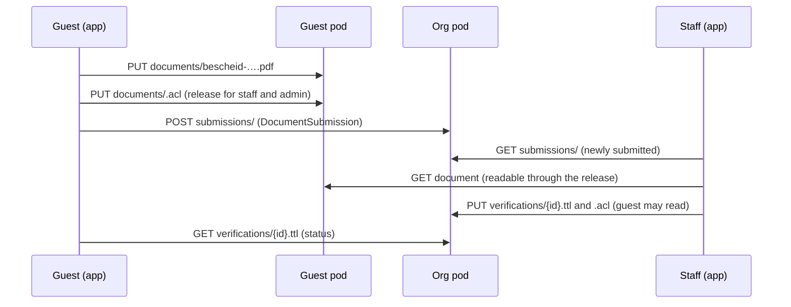
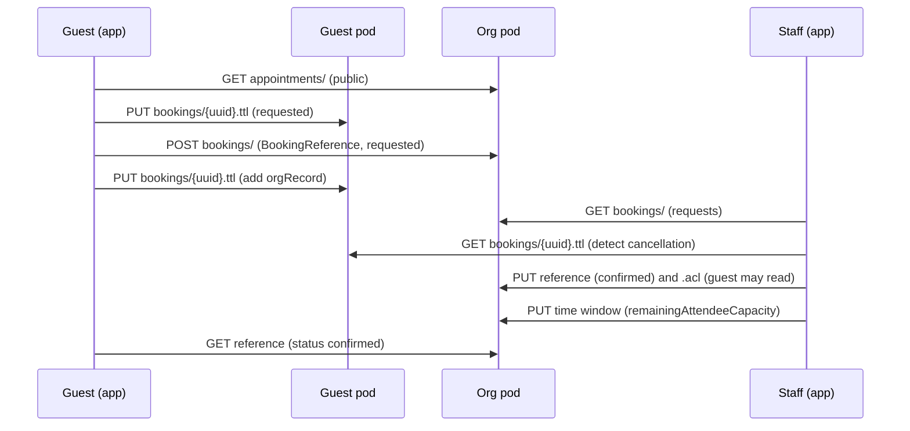

# Requirements Specification (Pflichtenheft) — Tafel Calendar App "solid-tafel"

| | |
|---|---|
| **Document version** | 1.1 — draft after cross-check (changes compared to 1.0: Appendix C) |
| **Baseline** | App v0.0.9 (live) · vocabulary `ns.ttl` v0.3 · `pod-layout.md` (v0.0.9) |
| **Target state** | MVP for **one** location (Tafel Herford) |
| **Author** | Pal (meisdata / ewingson), developed with Claude |
| **Language** | English translation of the German original `pflichtenheft.md`; file names, classes and properties are English as in the code; text shown in the user interface stays German |
| **Location in the repo** | `doc/requirements-specification.md` |

## Reading notes (for beginners)

- **Priority:** **M** = must (the MVP does not work without it) · **S** = should (important, but does not block the MVP) · **K** = could (later). (The letter K comes from the German "Kann".)
- **IDs:** `AF-` architecture decision · `FA-` functional requirement · `NFA-` non-functional requirement · `D-` open decision · `R-` risk · `T-` task (to-do) · `S-` security test.
- **Learning note** marks places where Solid beginners usually stumble.
- **`{POD}`** stands for the root URL of a pod **with** a trailing `/`, e.g. `https://teamid.live/herford/`. An address is therefore written as `{POD}solid-tafel/bookings/`.
- **There are deliberately no time estimates.** The order of the milestones is binding, schedules are not.
- Everything that was already decided in earlier conversations is written as a **decision**. Everything still open is in the **decision log (section 14)** with a recommendation.

---

## 1. Objectives

### 1.1 Goal

A plain web app with which **Tafel Herford**

1. offers **pickup time windows**,
2. lets **guests (end consumers)** **book** a time window,
3. lets guests upload their **notice (Bescheid) as a PDF**,
4. lets **staff** confirm bookings and give the notice a **status** (`verified` / `pending` / `rejected` / `expired`).

All personal data stays in **Solid pods**. There is no custom server software, only static files (HTML/JS/CSS) at serverproject.de.

### 1.2 Must criteria (short version)

- [ ] One (1) org pod (Herford); configuration so that further org pods are possible later.
- [ ] Roles: **guest**, **staff**, **admin**; the role is determined from the org pod and never claimed by the user.
- [ ] Staff create, change and cancel time windows.
- [ ] A guest sees time windows and can book within a time window (status: `requested` → `confirmed` / `cancelled`).
- [ ] A guest uploads a notice as a PDF into their own pod.
- [ ] Staff check the notice and set the status (`verified` / `pending` / `rejected` / `expired`).
- [ ] A guest sees the status of the booking and of the notice.
- [ ] Plain UI, in German, usable on a phone.

### 1.3 Non-goals (deliberately not in the MVP)

- Second location (Bielefeld) and location selection
- A user interface for maintaining the staff lists (maintenance is manual, see FA-R4)
- E-mail/push notifications, automatic reminders
- Server-side logic (cron jobs, webhooks)
- Calendar widget (there is a plain list)
- Automatic creation of pods for guests
- Statistics and reports
- Multiple languages (German only)
- Offline operation

### 1.4 Assessment of "CRUD is no bigger problem"

Honestly: **yes, but only half.** Reading, creating, changing and deleting resources is easy in Solid (`GET`, `PUT`, `POST`, `DELETE` with the existing authenticated `fetch` function). Three other things are hard, and the plan is built around them:

1. **Permissions across pod boundaries.** Who may read in whose pod, and who may write the access rules (`.acl`)?
2. **Consistency without transactions.** Solid has no "count down atomically" operation. The capacity of a time window therefore cannot be consumed safely by two guests at the same time. Solution: staff confirm bookings (section 5.2 and FA-B5).
3. **Privacy and onboarding.** A notice is sensitive, and guests first need to have a pod (risk R-01).

---

## 2. Starting point

### 2.1 What already exists (v0.0.9, live)

| Existing | Remark |
|---|---|
| Solid-OIDC login/logout | `@inrupt/solid-client-authn-browser` 4.0.0 |
| Read and parse the profile | `N3` 2.0.3, 7 debug parameters |
| Restore the session | via the Inrupt library, `localStorage` only as a hint |
| "Get a Pod" link | start page for guests |
| Regression tests | 14 jsdom scenarios against the real libraries |
| Vocabulary `ns.ttl` | `https://serverproject.de/solid-tafel/ns.ttl#`, served as `text/turtle` |
| Pod concept | `doc/pod-layout.md` (needs corrections, see Appendix B) |

The app **does not write anything yet**. There is no write path so far.

### 2.2 Assumptions

| ID | Assumption |
|---|---|
| A-1 | The org pod Herford runs on a Community Solid Server (CSS) instance; URL and WebID are fixed (section 2.3). |
| A-2 | Guests have a pod with any provider (e.g. solidweb.org, teamid.live). The app does not provide a pod. |
| A-3 | Staff and admin have WebIDs that Pal enters into the group documents. |
| A-4 | The org pod is configured so that foreign identity providers (other issuers) are accepted. This has to be tested (T-0.9). |
| A-5 | At most about 100 bookings are expected per time window. |
| A-6 | The org pod and the first test guest are on the **same server** (teamid.live). That is enough for development, but it does **not** prove that access across server boundaries works (see R-02, R-12, T-0.3). |

### 2.3 Fixed accounts

| Purpose | Pod | WebID |
|---|---|---|
| **Org pod = admin pod** (Herford) | `https://teamid.live/herford/` | `https://teamid.live/herford/profile/card#me` |
| **Test guest** | `https://teamid.live/tafel_test/` | `https://teamid.live/tafel_test/profile/card#me` |

Further test accounts are listed in T-0.3. The pod `tafel_test` was at one point planned as the location of the namespace; the namespace is now finally at `https://serverproject.de/solid-tafel/ns.ttl#`. If remnants of that are still in `tafel_test` (`ns`, `ns.acl`), they are removed (T-0.12).

---

## 3. Roles

### 3.1 One pod type, several roles

All pods are **architecturally the same**: ordinary Solid pods with a WebID, storage and access rules (AF-02). There is no "special pod" for the Tafel.

- The **org pod is at the same time the admin pod.** It belongs to the organisation (WebID `https://teamid.live/herford/profile/card#me`). Whoever holds this WebID is the owner and therefore admin.
- A **staff pod** is the completely ordinary pod of a staff member. The staff role does **not** arise from the pod, but from the fact that the person's WebID is listed in the staff list of the org pod.
- A **guest pod** is the completely ordinary pod of a guest.
- A **role is a relationship** between a WebID and the organisation, not a property of a pod. The same person can be a guest in another context.

### 3.2 Role table

| Role | How recognised | May | May not |
|---|---|---|---|
| **Visitor** (not logged in) | no session | start login, "Get a Pod", read the privacy notice; optionally view time windows (FA-Z6, K) | everything else |
| **Guest** (end consumer, `consumer`) | logged in, WebID in no group | view time windows; request and cancel bookings; upload, view and delete PDFs; grant and revoke the release (Freigabe); see own statuses | change time windows; read other people's data; set statuses |
| **Staff** | WebID is listed in `staff/herford.ttl` | everything a guest may, plus: create, change and cancel time windows; confirm or reject requests; daily list; view submitted notices (only if released) and set the status | change the staff lists |
| **Admin** | WebID is that of the org pod (`ORG_WEBID`, automatic) **or** is listed in `staff/admins.ttl` | everything staff may, plus clean-up of expired data (FA-V6); staff and admin lists have no user interface in the MVP, maintenance is manual (FA-R4) | – |

> **Learning note (important):** The app **hides** functions depending on the role. That is only a convenience. **The real security is the access rules (ACL) of the pods.** Someone who opens the developer console can bypass the user interface, but not the ACL. Therefore every permission requirement in this document applies twice: once in the user interface, once in the ACL.

---

## 4. Architecture decisions (from the decisions made so far)

| ID | Decision |
|---|---|
| AF-01 | Pure client app (HTML + JavaScript), delivered statically from serverproject.de. No server logic of its own. |
| AF-02 | **All pods have the same architecture** (org/admin pod, staff pods, guest pods): ordinary Solid pods; all app data lives in the container `{POD}solid-tafel/` with **the same set of sub-containers** (6.1). Differences arise only from **ACL, data content and role**, never from a different schema. |
| AF-03 | **One** org pod in the MVP: `https://teamid.live/herford/` with WebID `https://teamid.live/herford/profile/card#me`. Configuration in `config.js` as a list with one entry (`podUrl`, `webId`, `locationCode`), future-proof. |
| AF-04 | Roles come exclusively from the org pod: from the WebID of the org pod itself and from the group documents (`vcard:Group` + `vcard:hasMember`), never from the user's own profile. |
| AF-05 | **Hybrid:** the notice PDF and the original of the booking are in the guest pod. The org pod holds only references and results. |
| AF-06 | Vocabulary: `https://serverproject.de/solid-tafel/ns.ttl#` (hash namespace), `tafel:Appointment` is a `schema:Event`. |
| AF-07 | Group documents are **publicly readable**, only the admin may write. |
| AF-08 | **The root of trust is the owner of the org pod.** Their WebID (`ORG_WEBID`) is **automatically admin**, because it owns the pod and has `Control` in every ACL of the org pod. The owner enters further admins **as data** in `staff/admins.ttl`. The first admin therefore needs no entry and is not "hardwired" in the role logic; only the identity of the org pod is fixed, in `config.js`. |
| AF-09 | Verification results are kept for **6 months**. |
| AF-10 | A pod is a prerequisite for guests; the app only offers the "Get a Pod" link. |
| AF-11 | No transactions: capacity is secured by confirmation by staff, not by locks. |
| AF-12 | Role determination is **fail-open**: on errors one is treated as a guest (lowest rights). |
| AF-13 | No build step. JavaScript modules via `<script type="module">`, libraries as files (see NFA-01). |
| AF-14 | **Content from inboxes is not trustworthy.** Everything that guests append in `bookings/` or `submissions/` of the org pod (texts, URLs), and all files in guest pods, is treated as foreign input (FA-V8, FA-D2, FA-V2). |

---

## 5. Data model

### 5.1 Objects at a glance

| Object | Class | Located in | Created by | Read by |
|---|---|---|---|---|
| Time window | `tafel:Appointment` (`schema:Event`) | org pod `appointments/` | staff | everyone (public) |
| Booking (original) | `tafel:Booking` | guest pod `bookings/` | guest | guest, staff (if released) |
| Booking reference | `tafel:BookingReference` | org pod `bookings/` | guest (append), staff changes the status | staff; the guest only their own (after staff grant it) |
| Notice (PDF) | file `application/pdf` | guest pod `documents/` | guest | guest, staff (if released) |
| Submission | `tafel:DocumentSubmission` (**new**) | org pod `submissions/` | guest (append) | staff |
| Verification result | `tafel:Verification` | org pod `verifications/` | staff | staff; the guest only their own |
| Staff/admin list | `vcard:Group` | org pod `staff/` | admin (manual) | everyone |

### 5.2 Status codes

**Booking** (`tafel:bookingStatus`, already in the vocabulary):

| Code | Display (German UI text) | Who sets it |
|---|---|---|
| `tafel:requested` | Angefragt (requested) | guest (on creation) |
| `tafel:confirmed` | Bestätigt (confirmed) | staff |
| `tafel:cancelled` | Storniert (cancelled) | guest (cancellation) or staff (rejection/cancellation) |

A request rejected by staff is simply `cancelled`. A fourth code is not needed.

**Display status of the booking.** The status exists in two places: in the original (guest pod) and in the reference (org pod). The app derives **one** display status from them:

| Original (guest pod) | Reference (org pod) | Display |
|---|---|---|
| `cancelled` | any | **Storniert (durch Gast)** (cancelled by guest) |
| `requested` | `cancelled` | **Storniert (durch Tafel)** (cancelled by the Tafel) |
| `requested` | `confirmed` | **Bestätigt** (confirmed) |
| `requested` | `requested` | **Angefragt** (requested) |

Why two places? The guest may change their original (cancellation), but not the reference in the org pod. Staff may change the reference, but not the original in the guest pod.

**Notice** (`tafel:verificationStatus`, already in the vocabulary):

| Code | Display (German UI text) | Meaning |
|---|---|---|
| `tafel:pending` | In Prüfung (under review) | submitted, not yet decided (or deliberately put on hold by staff) |
| `tafel:verified` | Geprüft, gültig (checked, valid) | confirmed by staff |
| `tafel:rejected` | Abgelehnt (rejected) | rejected by staff |
| `tafel:expired` | Abgelaufen (expired) | validity is over |

**Display status of the notice** (derived, so that no server job is needed):

1. There is no submission → **"Kein Bescheid eingereicht" (no notice submitted)**.
2. The **latest submission** of the person is the relevant one (by `dcterms:created`).
3. There is no verification for exactly this document → **`pending`** (under review).
4. There is a verification → its status; if it is `verified` and `validUntil` is in the past → **`expired`**.
5. A verification that refers to another (older) document does not count.

### 5.3 Examples (Turtle)

These prefixes apply to all examples in this document:

```turtle
@prefix tafel:   <https://serverproject.de/solid-tafel/ns.ttl#> .
@prefix schema:  <https://schema.org/> .
@prefix dcterms: <http://purl.org/dc/terms/> .
@prefix xsd:     <http://www.w3.org/2001/XMLSchema#> .
@prefix foaf:    <http://xmlns.com/foaf/0.1/> .
@prefix vcard:   <http://www.w3.org/2006/vcard/ns#> .
@prefix acl:     <http://www.w3.org/ns/auth/acl#> .
```

**Time window** (`…/appointments/2026-11-04-1000.ttl`):

```turtle
<#this> a tafel:Appointment ;
    schema:name "Lebensmittelausgabe"@de ;
    schema:startDate "2026-11-04T10:00:00+01:00"^^xsd:dateTime ;
    schema:endDate "2026-11-04T12:00:00+01:00"^^xsd:dateTime ;
    schema:maximumAttendeeCapacity 40 ;
    schema:remainingAttendeeCapacity 40 ;
    schema:eventStatus schema:EventScheduled ;
    tafel:location tafel:herford .
```

**Booking, original in the guest pod** (`…/solid-tafel/bookings/3f2a….ttl`):

```turtle
<#this> a tafel:Booking ;
    tafel:forAppointment <https://teamid.live/herford/solid-tafel/appointments/2026-11-04-1000.ttl#this> ;
    tafel:bookingStatus tafel:requested ;
    tafel:orgRecord <https://teamid.live/herford/solid-tafel/bookings/a7c1> ;
    dcterms:created "2026-10-20T09:15:00Z"^^xsd:dateTime .
```

**Booking reference in the org pod** (`…/solid-tafel/bookings/a7c1`):

```turtle
<#this> a tafel:BookingReference ;
    tafel:forAppointment <https://teamid.live/herford/solid-tafel/appointments/2026-11-04-1000.ttl#this> ;
    tafel:bookedBy <https://teamid.live/tafel_test/profile/card#me> ;
    tafel:bookingResource <https://teamid.live/tafel_test/solid-tafel/bookings/3f2a.ttl#this> ;
    tafel:bookingStatus tafel:requested ;
    dcterms:created "2026-10-20T09:15:02Z"^^xsd:dateTime .
```

**Submission** (`…/solid-tafel/submissions/b410`):

```turtle
<#this> a tafel:DocumentSubmission ;
    tafel:forPerson <https://teamid.live/tafel_test/profile/card#me> ;
    tafel:forDocument <https://teamid.live/tafel_test/solid-tafel/documents/bescheid-20261020T091500Z.pdf> ;
    dcterms:created "2026-10-20T09:15:03Z"^^xsd:dateTime .
```

**Verification result** (`…/solid-tafel/verifications/9d3e.ttl`):

```turtle
<#this> a tafel:Verification ;
    tafel:forPerson <https://teamid.live/tafel_test/profile/card#me> ;
    tafel:forDocument <https://teamid.live/tafel_test/solid-tafel/documents/bescheid-20261020T091500Z.pdf> ;
    tafel:verificationStatus tafel:verified ;
    tafel:verifiedBy <https://teamid.live/tafel_staff/profile/card#me> ;
    tafel:verifiedOn "2026-10-21"^^xsd:date ;
    tafel:validUntil "2027-04-21"^^xsd:date .
```

**Staff group** (`…/solid-tafel/staff/herford.ttl`):

```turtle
<#staff> a vcard:Group ;
    vcard:hasMember <https://teamid.live/tafel_staff/profile/card#me> ,
                    <https://staff2.example/profile/card#me> .
```

> **Learning note, time zone:** Always store times with an offset (`+01:00` in winter, `+02:00` in summer) and format them for display with `toLocaleString('de-DE', { timeZone: 'Europe/Berlin' })`. Never store "naked" times without a time zone, otherwise appointments shift at the daylight-saving change.

### 5.4 Changes to the vocabulary

The existing `ns.ttl` v0.3 is not sufficient. It needs **additive** extensions for v0.4 (list in **Appendix A**). Terms that have already been published are **never renamed or deleted**, because data in pods refers to them.

---

## 6. Access concept

### 6.1 Uniform structure of every pod

Every pod (org/admin pod, staff pod, guest pod) gets **the same** set of containers. Containers that are not needed are **not created at all** (only on first write) and stay private until then (default ACL of the owner).

```
{POD}solid-tafel/
├── profile/          settings of the pod owner (optional in the MVP)
├── documents/        files the owner holds (guest: notice PDFs)
├── bookings/         guest pod: own bookings (originals) · org pod: booking references (inbox)
├── appointments/     org pod: time windows (publicly readable)
├── submissions/      org pod: submissions of notices (inbox)
├── verifications/    org pod: verification results
└── staff/
    ├── admins.ttl    vcard:Group  <#admins>   (org pod)
    └── herford.ttl   vcard:Group  <#staff>    (org pod; file name = location code)
```

### 6.2 Who uses which container?

| Container | Org/admin pod (`https://teamid.live/herford/`) | Staff pod | Guest pod (e.g. `https://teamid.live/tafel_test/`) |
|---|---|---|---|
| `profile/` | optional (location settings) | – | – (in the MVP; `tafel:homeLocation` only with the second org pod) |
| `documents/` | – | – | notice PDFs |
| `bookings/` | `tafel:BookingReference` (inbox) | – | `tafel:Booking` (originals) |
| `appointments/` | `tafel:Appointment` | – | – |
| `submissions/` | `tafel:DocumentSubmission` (inbox) | – | – |
| `verifications/` | `tafel:Verification` | – | – |
| `staff/` | group documents | – | – |

In the MVP a **staff pod** uses **no** container: the staff role is in the staff list of the org pod, not in the person's pod. The same applies to further admins.

The same container name can hold different records in different pods (`bookings/`). That is intended: the name says **what** it is about; the ACL and the record type say **whom** it belongs to.

### 6.3 Permission matrix, org pod

The matrix describes a pod **in the role of the org pod**. All other pods use the ACLs from 6.4; their remaining containers stay unused and private.

| Container | Public | Logged in (guest) | Staff | Admin |
|---|---|---|---|---|
| `appointments/` | read | read | read, write | read, write, control |
| `bookings/` | – | **append** | read, write; control over contents* | read, write, control |
| `submissions/` | – | **append** | read, write; control over contents* | read, write, control |
| `verifications/` | – | – (a single file only via an individual ACL, see 6.5) | read, write; control over contents* | read, write, control |
| `staff/` | read | read | read | write, control |
| `profile/` | – | – | read | write, control |

\* "Control over contents" means `acl:Control` **only as `acl:default`** (it applies to the files in the container, not to the ACL of the container itself). Staff must be able to write individual ACLs so that a guest may read their own result. Staff may not change the ACL of the container itself.

> **Learning note 1 — writing `.acl` needs `acl:Control`.** Whoever wants to write an `.acl` file needs control over the corresponding resource. "Write" is not enough. The original matrix in `pod-layout.md` had a gap here (Appendix B).
>
> **Learning note 2 — WAC does not inherit additively.** As soon as a resource has its **own** `.acl`, **only that one** applies. The rules of the container are **not** added. An individual ACL must therefore list **all** authorised parties again (org pod, admin, staff **and** the guest).
>
> **Learning note 3 — locking yourself out.** Whoever writes an ACL without giving themselves `Control` loses access. The app therefore checks before every ACL write that the owner keeps `Control` (FA-D3).

### 6.4 Permissions in the guest pod (after release)

| Container | Guest (owner) | Staff group, admin group and org WebID | Everyone else |
|---|---|---|---|
| `documents/` | read, write, control | **read** (only after release, revocable) | – |
| `bookings/` | read, write, control | **read** (only after release, revocable) | – |

The **release** (Freigabe) is a deliberate act of the guest (FA-D3). Without it, staff cannot read anything in the guest pod. This is also the privacy core of the concept.

### 6.5 ACL templates

**(a) Guest pod, `documents/.acl` and `bookings/.acl`** (after release):

```turtle
<#owner> a acl:Authorization ;
    acl:agent <https://teamid.live/tafel_test/profile/card#me> ;
    acl:accessTo <./> ; acl:default <./> ;
    acl:mode acl:Read, acl:Write, acl:Control .

<#tafel-staff> a acl:Authorization ;
    acl:agent <https://teamid.live/herford/profile/card#me> ;
    acl:agentGroup <https://teamid.live/herford/solid-tafel/staff/herford.ttl#staff> ,
                   <https://teamid.live/herford/solid-tafel/staff/admins.ttl#admins> ;
    acl:accessTo <./> ; acl:default <./> ;
    acl:mode acl:Read .
```

**(b) Org pod, `bookings/.acl` and `submissions/.acl`:**

```turtle
<#owner> a acl:Authorization ;
    acl:agent <https://teamid.live/herford/profile/card#me> ;
    acl:accessTo <./> ; acl:default <./> ;
    acl:mode acl:Read, acl:Write, acl:Control .

<#admins> a acl:Authorization ;
    acl:agentGroup <https://teamid.live/herford/solid-tafel/staff/admins.ttl#admins> ;
    acl:accessTo <./> ; acl:default <./> ;
    acl:mode acl:Read, acl:Write, acl:Control .

<#staff-container> a acl:Authorization ;
    acl:agentGroup <https://teamid.live/herford/solid-tafel/staff/herford.ttl#staff> ;
    acl:accessTo <./> ;
    acl:mode acl:Read, acl:Write .

<#staff-contents> a acl:Authorization ;
    acl:agentGroup <https://teamid.live/herford/solid-tafel/staff/herford.ttl#staff> ;
    acl:default <./> ;
    acl:mode acl:Read, acl:Write, acl:Control .

<#guests-append> a acl:Authorization ;
    acl:agentClass acl:AuthenticatedAgent ;
    acl:accessTo <./> ;
    acl:mode acl:Append .
```

**(c) Individual ACL for a verification result or a confirmed booking reference** (`verifications/9d3e.ttl.acl`). It is written by staff as soon as there is something to show:

```turtle
<#owner> a acl:Authorization ;
    acl:agent <https://teamid.live/herford/profile/card#me> ;
    acl:accessTo <9d3e.ttl> ;
    acl:mode acl:Read, acl:Write, acl:Control .

<#admins> a acl:Authorization ;
    acl:agentGroup <https://teamid.live/herford/solid-tafel/staff/admins.ttl#admins> ;
    acl:accessTo <9d3e.ttl> ;
    acl:mode acl:Read, acl:Write, acl:Control .

<#staff> a acl:Authorization ;
    acl:agentGroup <https://teamid.live/herford/solid-tafel/staff/herford.ttl#staff> ;
    acl:accessTo <9d3e.ttl> ;
    acl:mode acl:Read, acl:Write, acl:Control .

<#person> a acl:Authorization ;
    acl:agent <https://teamid.live/tafel_test/profile/card#me> ;
    acl:accessTo <9d3e.ttl> ;
    acl:mode acl:Read .
```

The templates are **drafts**. Whether the target CSS version evaluates them exactly like this (in particular `acl:agentGroup` across server boundaries and `acl:default` only for control) is checked in the security tests (section 11.6) before any code is built on it.

### 6.6 Setting up the org pod (once, manual)

The org pod `https://teamid.live/herford/` already exists (section 2.3). Its contents are missing:

1. Check the WebID: `https://teamid.live/herford/profile/card#me` is reachable and returns Turtle.
2. Create the container `solid-tafel/` with the sub-containers the org pod uses (`appointments/`, `bookings/`, `submissions/`, `verifications/`, `staff/`, optionally `profile/`).
3. Create the group documents `staff/admins.ttl` (`<#admins>`) and `staff/herford.ttl` (`<#staff>`). **`admins.ttl` may initially be empty** (a group without members), because the owner of the org WebID is automatically admin (AF-08). Staff members are entered in `herford.ttl`.
4. Set the ACL files: template (b) for `bookings/` and `submissions/`; `verifications/` like (b) but without `guests-append`; `appointments/` publicly readable; `staff/` publicly readable, only admin and owner write.
5. Are the group documents retrievable **without login**? (`curl` without a header) → must return `200`.
6. Test run with the test accounts from T-0.3 (security tests, section 11.6).
7. Record the steps as `doc/runbook-org-pod.md`.

> **Who logs in as the org pod owner?** The account `herford` is a shared organisation account. Recommendation (D-15): use it only for setup and emergencies. In daily operation, admins enter their **personal** WebID in `admins.ttl`.

---

## 7. Functional requirements

### 7.1 Foundation (K)

| ID | Prio | Requirement | Acceptance criteria |
|---|---|---|---|
| FA-K1 | M | **Central configuration** in `config.js`: org pods (each `podUrl`, `webId`, `locationCode`), namespace URL, file size limit; group URLs are derived from these. | All URLs are only there (sketch in 11.2). Changing the org pod URL = a change in exactly one place. Org pods as a list with one entry. `podUrl` ends with `/`. |
| FA-K2 | M | **Pod access layer** `pod.js`: read (Turtle), write (Turtle), append (`POST`), write a binary file, read a binary file (blob), delete, list a container. | No `fetch` in the UI code. Errors (401, 403, 404, 409, 412, 5xx, network) are translated into understandable error objects. "404 when reading" means "not present", not an error. |
| FA-K3 | M | **German user interface.** All visible texts in `strings.de.js`. | No German text scattered through the code. Date and time in `de-DE`, time zone `Europe/Berlin`. |
| FA-K4 | M | **Uniform feedback:** loading, success, error. | Every action shows a loading state. Errors are worded without technical details for guests, technical details only in the console. Action buttons are disabled while an action runs (no double-click problem). |
| FA-K5 | S | Version display and change log. | The version is in one place (`APP_VERSION`); `CHANGELOG.md` is maintained. |

### 7.2 Roles (R)

| ID | Prio | Requirement | Acceptance criteria |
|---|---|---|---|
| FA-R1 | M | **Role determination after login.** (1) If the WebID equals `ORG_WEBID`, it is `admin` (without a network request). (2) Otherwise the app reads `staff/admins.ttl` and `staff/herford.ttl` of the org pod and checks `vcard:hasMember`. | Result: `admin` before `staff` before `consumer`. WebID comparison is exact. The role is **never** taken from `localStorage`. Test: login with `https://teamid.live/herford/profile/card#me` yields `admin`, even with an empty `admins.ttl`. |
| FA-R2 | M | **Fail-open.** | 404 or a network error when reading a group = "not a member". In addition a notice "Role could not be determined reliably" appears (so that staff are not surprised when functions are missing). |
| FA-R3 | M | **Role symbol** in the header (symbol **and** text). | Guest, staff member, admin can be told apart, even without colour. |
| FA-R4 | M | **Manual staff and admin maintenance** (operating manual, no code). | `doc/runbook-org-pod.md` describes: add staff, remove staff, enter a further admin, manage access to the organisation account (D-15). |
| FA-R5 | M | **Menus per role** (only a convenience, not security). | See section 9. Direct calls without permission fail at the ACL. |
| FA-R6 | S | Reload the role without logging in again. | Button "Rolle neu prüfen" (re-check role). |

### 7.3 Time windows (Z), only staff and admin write

| ID | Prio | Requirement | Acceptance criteria |
|---|---|---|---|
| FA-Z1 | M | **Create.** Date, start, end, places (capacity), optional note text. | Checks: end after start, places ≥ 1, not in the past. File `appointments/YYYY-MM-DD-HHMM.ttl` (suffix `-2` on a collision). The file contains `tafel:Appointment`, `schema:EventScheduled`, `remainingAttendeeCapacity` = capacity. |
| FA-Z2 | M | **View (read)** for all roles. | Future time windows, sorted ascending, with date, time, "Frei: x von y" (free: x of y). Cancelled ones are marked. Past ones are hidden (staff: filter "also past"). Listing filters by file name before each file is loaded. |
| FA-Z3 | M | **Change (update).** | Capacity must not fall below the number of confirmed bookings. When the time is changed while bookings exist, a warning appears. Writing with `If-Match`/ETag if the server provides it; on `412` it reloads. |
| FA-Z4 | M | **Cancel and delete.** | The default is **cancel** (`schema:EventCancelled`). The associated bookings appear as "Storniert (durch Tafel)" (staff action "cancel all"). **Deleting** the file is allowed only without bookings. |
| FA-Z5 | K | Copy windows from the previous week. | – |
| FA-Z6 | K | View time windows without login. | The container is publicly readable; a read-only view without a session is enough. |

### 7.4 Booking (B)

| ID | Prio | Requirement | Acceptance criteria |
|---|---|---|---|
| FA-B1 | M | **Request a booking (create).** | Prerequisites: release active (FA-D3), window not cancelled, start in the future, free places according to the display, no active booking by the guest in the same window. Flow: (1) create the original in the guest pod with `requested`, (2) `POST` the reference into the org pod, (3) add `tafel:orgRecord` to the original. If (2) fails, (1) is rolled back and the guest sees a clear message. It must never look "booked" without the org pod having a reference. |
| FA-B2 | M | **Show own bookings (read).** | List from the own `bookings/`; display status according to the table in 5.2. Time window details are loaded afterwards. |
| FA-B3 | M | **Cancel (update by the guest).** | The status of the original becomes `cancelled`. Only for future windows. Feedback "Storniert (durch Gast)". Deadline: D-03. |
| FA-B4 | M | **Request list for staff.** | Requests grouped by time window; per entry name, display status, **notice traffic light** (FA-V4). Actions: **confirm** and **reject** (= `cancelled`). When confirming, staff write the individual ACL so that the guest can read the reference. The original in the guest pod is read to detect cancellations. If a guest pod is unreachable, only this row is marked "nicht lesbar" (not readable), the list does not abort. References are validated before they are fetched (FA-V8). |
| FA-B5 | M | **Capacity.** | `remaining = maximum − number of confirmed bookings that are not cancelled`. Staff actions (confirm, reject, detected guest cancellation) write the value into the time window. In addition there is "recalculate". The guest view blocks requests when `remaining = 0`. **This is only a hurdle in the user interface**, not a hard protection. Overbooking through simultaneity is resolved by staff confirmation. |
| FA-B6 | M | **Daily list for staff:** confirmed bookings per time window. | Name (from the public profile, otherwise the WebID host), notice traffic light. Sortable by name. No more fields than necessary. |
| FA-B7 | S | **Print/export of the daily list** (print view or CSV). | Helps when the pod fails (risk R-04). |
| FA-B8 | S | **Booking rules** (e.g. at most one active booking per week). | Depends on D-03; adjustable in `config.js`. |

### 7.5 Notice document (D)

| ID | Prio | Requirement | Acceptance criteria |
|---|---|---|---|
| FA-D1 | M | **Upload a PDF (create).** | Only `application/pdf`; in addition a check of the first bytes (`%PDF-`); at most 10 MB (configurable). The file name is **generated**: `bescheid-<UTC timestamp>.pdf`, the original name does not enter the URL. Written by `PUT` with `Content-Type: application/pdf` into `documents/`. If the container is missing, it is created. |
| FA-D2 | M | **Show, view and delete own documents.** | List (newest first) with date and status. "View" loads the PDF with an authenticated `fetch` as a blob (**not** via a plain link, see learning note). The blob type is **fixed to `application/pdf`** (do not adopt the type reported by the server), and the first bytes (`%PDF-`) are checked before opening. "Delete" with a confirmation. |
| FA-D3 | M | **Grant and revoke the release to the Tafel.** | Explanatory text in plain language (who may see what, for how long, how to revoke). Writes the ACL (a) for `documents/` and `bookings/` (read access for the staff group, the admin group **and the org WebID**, because its owner is automatically admin). The state "release active" is read from the ACL (not from a flag). **Self-lock-out protection:** after writing, check that the owner has `Control`, otherwise abort/roll back. Revoking removes the group authorisation. |
| FA-D4 | M | **Report the submission.** | After the upload (and with an active release), a `POST` of a `tafel:DocumentSubmission` into `submissions/` in the org pod. Without release: the upload is kept, the app leads to the release and offers "Jetzt einreichen" (submit now). |
| FA-D5 | M | **Verification status for the guest.** | Display as in 5.2. Reads the result from `verifications/`; an answer `403/404` means "In Prüfung". For `verified`, "gültig bis" (valid until) is shown. |
| FA-D6 | M | **A new document replaces the old one.** | Files are immutable (a new name per upload); the latest submission counts (5.2). A new upload automatically sets the display status to "In Prüfung", because the result refers to another document. |

> **Learning note — opening protected PDFs:** A plain link `<a href="…pdf">` sends **no** login token and returns `401`. The app must load the PDF with `solidClientAuthentication.fetch`, create a temporary address with `URL.createObjectURL(blob)` and display that. Afterwards call `URL.revokeObjectURL`.

### 7.6 Verification (V), only staff and admin

| ID | Prio | Requirement | Acceptance criteria |
|---|---|---|---|
| FA-V1 | M | **List of submitted notices.** | Reads `submissions/` and `verifications/`; per person the latest submission counts. Filter, default: "Zu prüfen" (to be checked: without result or `pending`). |
| FA-V2 | M | **View the document.** | As FA-D2 via blob **with a fixed type and a first-bytes check**. If the file is not a PDF, it is **not opened** and staff see a warning. On `403` (no release or revoked) an understandable message appears. |
| FA-V3 | M | **Set the status** (`verified` / `pending` / `rejected` / `expired`). | Inputs: status, "valid until" (default for `verified`: verification date + 6 months, staff may shorten it), optional short note (at most 200 characters, hint "no sensitive data"). Writes `verifications/<uuid>.ttl` (one result per document, `If-Match` on change) **and** the individual ACL (6.5 c), so that the guest can read it. |
| FA-V4 | M | **Display status rule** (5.2) as **one** reusable function with tests. | Used identically in the guest view, request list, daily list and notice list. **Traffic light:** symbol **and** text, not only colour. |
| FA-V5 | M | **Log fields automatically.** | `verifiedBy` = WebID of the session, `verifiedOn` = today's date. Not editable by hand. |
| FA-V6 | S | **Clean-up** (admin): delete results after the retention period has expired. | Button "Abgelaufene Ergebnisse löschen" (delete expired results) with a preview and a confirmation (see D-07). |
| FA-V7 | K | **Document hash** in the result (SHA-256) to detect later overwriting. | Prevents a guest from secretly swapping the file after the check. In the MVP, immutable file names (FA-D6) as a convention are enough. |
| FA-V8 | M | **Check references from inboxes** before the app fetches them (`tafel:forDocument`, `tafel:bookingResource`). | Only `https`; **same origin** as the WebID in `tafel:forPerson` or `tafel:bookedBy`; the path contains `/solid-tafel/documents/` or `/solid-tafel/bookings/`. Otherwise the entry is skipped with a warning and **not fetched**. Reason: the authenticated request of the staff session must not be steered to freely chosen foreign addresses. |

---

## 8. Flows

### 8.1 Upload a notice, release it, check it



### 8.2 Booking



### 8.3 First use by a guest (order of the screens)

1. Log in (with their own pod provider) → the role is determined (guest).
2. Notice "release" → the guest grants the release (or skips it for now).
3. "Mein Bescheid" (my notice) → upload a PDF → it is submitted.
4. "Zeitfenster" (time windows) → choose a window → "Anfragen" (request).
5. "Meine Buchungen" (my bookings) → follow the status (requested → confirmed).

---

## 9. User interface (plain)

**Basic layout:** header (name of the app, version, role symbol with text, display name, "Abmelden" = log out), below it tabs, below it the content, below it a uniform status line.

| Role | Tabs |
|---|---|
| Guest | Zeitfenster · Meine Buchungen · Mein Bescheid · Datenschutz |
| Staff | Heute (daily list) · Zeitfenster verwalten · Anfragen · Bescheide prüfen · Datenschutz |
| Admin | like staff, plus Wartung (clean-up) |

**Sketch "Zeitfenster" (guest):**

```
Zeitfenster
┌──────────────────────────────────────────────┐
│ Mi, 04.11.2026   10:00–12:00 Uhr             │
│ Frei: 12 von 40                [ Anfragen ]  │
├──────────────────────────────────────────────┤
│ Mi, 11.11.2026   10:00–12:00 Uhr             │
│ Ausgebucht                                   │
└──────────────────────────────────────────────┘
```

**Sketch "daily list" (staff):**

```
Mi, 04.11.2026   10:00–12:00 Uhr     Bestätigt: 28 von 40
┌─────────────────────────┬────────────────────┐
│ Name                    │ Bescheid           │
├─────────────────────────┼────────────────────┤
│ A. Beispiel             │ ✔ Geprüft, gültig  │
│ B. Muster               │ ⏳ In Prüfung       │
│ C. Test                 │ ✖ Abgelaufen       │
└─────────────────────────┴────────────────────┘
```

**Design rules:**

- Phone first (usable from 360 px width), large buttons, one column.
- Every view knows four states: **loading**, **empty** ("Keine Zeitfenster"), **error**, **content**.
- Status always with **symbol and text** (✔ ⏳ ✖ …), never with colour alone.
- Plain language, short sentences, informal/formal address (Du/Sie) used consistently (decision with Herford, D-11).
- Everything that comes from the pod (names, notes) is inserted with `textContent`, **never** with `innerHTML` (protection against injected code).

---

## 10. Non-functional requirements

| ID | Prio | Requirement |
|---|---|---|
| NFA-01 | M | **Privacy.** Notices contain sensitive social data. Before pilot operation: name the controller, involve the data protection officer, consent text (release), privacy notice in the app, deletion concept (AF-09). **Deliver libraries locally** (no CDN, no external fonts or stylesheets), because every external request transmits IP addresses to third parties. This is not legal advice. The legal assessment is clarified by the Tafel with its data protection officer. |
| NFA-02 | M | **Data minimisation.** The org pod stores only references and results, no copies of documents. |
| NFA-03 | M | **Security of the user interface.** No `innerHTML` with pod data, no `eval`. HTTPS only. Content-Security-Policy via `.htaccess` (S). No tokens or WebIDs in the console in production. Files are checked before upload (FA-D1). Foreign content (files from guest pods, references from inboxes) is never opened or fetched unchecked (FA-V2, FA-V8). |
| NFA-04 | M | **Access protection on the server** via ACL, not only in the user interface (section 3). |
| NFA-05 | M | **Robustness.** Network errors never lead to a white page. With several parallel requests: `Promise.allSettled`, one faulty entry does not make the list fail. Double-click protection. |
| NFA-06 | M | **Compatibility.** Current versions of Firefox, Chrome, Safari (also iOS) and Edge; phone first. |
| NFA-07 | S | **Accessibility.** Operable by keyboard, labelled fields, sufficient contrast (WCAG AA targeted), feedback via `aria-live`. |
| NFA-08 | M | **Maintainability.** Modules by task (section 11.1), constants central, business logic as **pure functions** without DOM access (testable), comments in one consistent language. |
| NFA-09 | M | **Testability.** See sections 11.5 to 11.6. |
| NFA-10 | S | **Performance.** Smooth up to about 100 entries; limit parallel requests (e.g. 6 at a time); cache group documents per session. |
| NFA-11 | M | **Operation.** Daily backup of the org pod; restore tested once; failure plan: printed or exported daily list (FA-B7). |
| NFA-12 | M | **Time.** Times with offset, display in `Europe/Berlin` (see learning note in 5.3). |
| NFA-13 | S | **Open source.** MIT licence, libraries used and their versions documented. Versions are raised only with a passing regression check. |

---

## 11. Technical implementation

### 11.1 Recommended file structure

So far the app consisted of `index.html` and `tlogic.js`. With write access it grows considerably. **Recommendation: split it up** (decision D-08). Without a build step this works with ES modules (`<script type="module" src="js/main.js">`).

```
src/
├── index.html
├── css/app.css
├── lib/                      libraries as local files (NFA-01)
└── js/
    ├── config.js             URLs, limits, location code
    ├── strings.de.js         all visible texts
    ├── auth.js               login/logout/session (from the existing tlogic.js)
    ├── pod.js                read/write/append/delete/list
    ├── roles.js              role determination (pure + retrieval)
    ├── acl.js                ACL generation (pure) + release/revoke
    ├── appointments.js       time windows
    ├── bookings.js           bookings
    ├── documents.js          notice upload
    ├── verification.js       check + display status rule (pure)
    ├── ui.js                 presentation (the only place with the DOM)
    └── main.js               start and wiring
doc/                          pflichtenheft.md, requirements-specification.md, pod-layout.md, ns.ttl, runbook-org-pod.md
test/                         jsdom regression + unit tests + integration tests
```

### 11.2 Libraries

- **Login:** `@inrupt/solid-client-authn-browser` (currently 4.0.0, update only with a regression test).
- **Read and write RDF:** `n3` (`N3.Parser`, `N3.Writer`, `N3.Store`). A further library (`@inrupt/solid-client`) is **not necessary**, because all access goes through the authenticated `fetch`. Fewer dependencies are easier for a beginner to oversee.
- All files are available **locally** before pilot operation (see NFA-01).

**Configuration sketch (`config.js`):**

```js
export const ORG_PODS = [
  {
    locationCode: 'herford',
    podUrl: 'https://teamid.live/herford/',                  // always ends with "/"
    webId:  'https://teamid.live/herford/profile/card#me'    // owner of the pod = implicit admin
  }
];
export const APP_ROOT = 'solid-tafel/';
export const NS = 'https://serverproject.de/solid-tafel/ns.ttl#';
export const MAX_PDF_BYTES = 10 * 1024 * 1024;
```

### 11.3 Sketch of the access layer (`pod.js`)

```js
// Sketch only. All pod access goes through these helpers.
const authFetch = (url, opts) => solidClientAuthentication.fetch(url, opts);

export async function getTurtle(url) {
  const res = await authFetch(url, { headers: { Accept: 'text/turtle' } });
  if (res.status === 404) return null;                 // not present is not an error
  if (!res.ok) throw podError(res, url);
  return { quads: new N3.Parser({ baseIRI: url }).parse(await res.text()),
           etag: res.headers.get('ETag') };
}

export async function putTurtle(url, turtle, etag) {
  const headers = { 'Content-Type': 'text/turtle' };
  if (etag) headers['If-Match'] = etag;                // detect concurrent edits
  const res = await authFetch(url, { method: 'PUT', headers, body: turtle });
  if (!res.ok) throw podError(res, url);
}

export async function postTurtle(containerUrl, turtle, slug) {
  const res = await authFetch(containerUrl, {
    method: 'POST',
    headers: { 'Content-Type': 'text/turtle', ...(slug && { Slug: slug }) },
    body: turtle
  });
  if (!res.ok) throw podError(res, containerUrl);
  return res.headers.get('Location');                  // URL of the new resource
}
```

> **Learning note — simultaneous changes:** Two staff members change the same time window. The pattern is: read (with ETag) → change → write back with `If-Match`. On `412`, reload and apply the change again. Whether the target CSS version supports ETags and `If-Match` is tested (T-0.9).

### 11.4 Pure functions (write and test first)

These functions know neither the DOM nor the network and can be secured with simple tests:

- `deriveBookingStatus(original, reference)` (table in 5.2)
- `deriveDocumentStatus(submissions, verifications, today)` (rules in 5.2)
- `remainingCapacity(maximum, bookings)`
- `validateAppointment(input, now)`
- `validatePdf(file, headerBytes, maxBytes)`
- `buildAccessControl(…)` (generates the ACL texts from 6.5)
- `roleFromGroups(webId, adminMembers, staffMembers)`

### 11.5 Tests

1. **Regression test (existing):** keep maintaining the 14 jsdom scenarios; with every extension add new scenarios (role, upload, booking, staff actions) with simulated pod responses.
2. **Unit tests** for all functions from 11.4, including edge cases (daylight-saving change, capacity 0, expired result, older submission).
3. **Integration tests against a local CSS instance** (`npx @solid/community-server`, file backend) with test accounts: upload, append, write ACL, list, delete. This decides whether the ACL templates work.
4. **Manual acceptance** with real pods (section 16), in particular a **guest pod with a different provider than the org pod**.

### 11.6 Security and permission tests (mandatory, including "negative" tests)

Negative tests ("this must **not** work") are just as important as positive ones.

| ID | Actor | Action | Expectation |
|---|---|---|---|
| S-01 | Guest A | reads the document of guest B | denied |
| S-02 | Guest | reads the container `bookings/` of the org pod | denied |
| S-03 | Guest | `POST` to `bookings/` and `submissions/` of the org pod | allowed (`201`) |
| S-04 | Guest | writes to `appointments/` | denied |
| S-05 | Guest | writes to `verifications/` | denied |
| S-06 | Staff | reads a guest document **without** release | denied |
| S-07 | Staff | reads a guest document **with** release | allowed |
| S-08 | Staff | reads a guest document after **revocation** | denied |
| S-09 | Guest | reads own verification result / someone else's | allowed / denied |
| S-10 | Non-admin | changes `staff/*.ttl` | denied |
| S-11 | Anonymous | reads `appointments/` and `staff/*.ttl` | allowed |
| S-12 | Staff, removed from the group | reads a guest document | denied (**mind the server's cache**) |
| S-13 | Staff | writes the individual ACL of a result file / the ACL of `staff/` | allowed / denied |
| S-14 | Guest | changes their own reference in the org pod (after `POST`) | denied |
| S-15 | Guest | submits a submission with `forDocument` pointing to a **foreign origin** | the staff app does **not** fetch the URL (FA-V8) |
| S-16 | Guest | stores a non-PDF file (e.g. HTML) as `.pdf` via the API | the staff app recognises it by the first bytes and does not open it (FA-V2) |

> **Note:** All tests in which the org pod and the guest pod are on the same server (teamid.live) do **not** check evaluation across server boundaries. S-06 to S-09 and S-12 must therefore additionally run with a guest pod on **a different server** (T-0.3, risk R-02).

---

## 12. Milestones

The order is binding. Version numbers are a proposal following the plan so far (0.0.10 … 0.1.0).

| Milestone | Proposed version | Content | Done when … (definition of done) |
|---|---|---|---|
| **M0** Preparation | – | Decisions, fill the org pod (the pod exists), test accounts, `ns.ttl` v0.4, corrections to `pod-layout.md`, local test environment | Security tests S-01 to S-14 passed with manually set ACLs (S-15 and S-16 follow with the app in M2); `ns.ttl` v0.4 is live (`curl -I` shows `text/turtle`) |
| **M1** Foundation, roles, upload | 0.0.10 | Split into modules, `config`/`strings`/`pod`, role determination and symbol, upload/view/delete PDF in the **own** pod (no release, no submission) | Regression test green; upload works with the test guest `tafel_test`; login with the org WebID yields `admin`, a test guest yields `consumer`; with an unreachable org pod the app stays usable as a guest |
| **M2** Release and verification | 0.0.11 | Release (ACL), submission, staff list, view document, set status, individual ACL, status display for guests | S-06 to S-09, S-12, S-13, S-15 and S-16 passed, **also with a guest pod on a different server**; a staff member sets all four statuses, the guest sees each |
| **M3** Time windows | 0.0.12 | Create, view, change, cancel/delete, ETag behaviour | Staff maintain windows, guests see them; test across the daylight-saving change passed |
| **M4** Booking | 0.0.13 | Request (3 steps with rollback), cancel, request list, confirm/reject, capacity, daily list, export | The scenario "two guests, one last place" leads to exactly one confirmation; the display status table (5.2) tested in all four cases |
| **M5** Hardening and pilot | 0.1.0 | local libraries, CSP, German texts agreed with Herford, accessibility, phone tests, privacy check, backup/restore, operating manual | Acceptance scenarios (section 16) passed; pilot with a few guests **accompanied by staff** |

> **Note on versioning:** Under the existing rule (0.1.0 = rough UI + first function), M1 would already be a candidate for 0.1.0. The proposal above keeps 0.1.0 free for the first complete MVP. This is purely a question of naming and can be decided differently at any time.

---

## 13. To-do list (mandatory tasks)

### M0 — Preparation

- [ ] **T-0.1** Clarify decisions D-01 to D-07 and D-12 with Herford; decide D-14 and D-15 internally (section 14).
- [ ] **T-0.2** Check the org pod `https://teamid.live/herford/` (reachable, the WebID `…/herford/profile/card#me` returns Turtle) and enter the values in `config.js`.
- [ ] **T-0.3** Provide test accounts (names of new accounts are suggestions):
  - [ ] Org pod/admin: `https://teamid.live/herford/` (exists)
  - [ ] Test guest 1: `https://teamid.live/tafel_test/` (exists)
  - [ ] Test guest 2: e.g. `https://teamid.live/tafel_test2/` (for S-01, S-14, S-15)
  - [ ] Test staff: e.g. `https://teamid.live/tafel_staff/` (enter in `staff/herford.ttl`)
  - [ ] Test guest X on a **different server** (e.g. solidweb.org or solidweb.me, both operated by Pal) for all tests across server boundaries
- [ ] **T-0.4** Set up containers, group documents and ACLs according to 6.6 (`admins.ttl` may stay empty; the org WebID is automatically admin).
- [ ] **T-0.5** Write `doc/runbook-org-pod.md` (setup, add/remove staff, change admin, backup).
- [ ] **T-0.6** Extend `ns.ttl` to v0.4 (Appendix A), check validity with N3, upload, verify with `curl -I`.
- [ ] **T-0.7** Correct `pod-layout.md` according to Appendix B.
- [ ] **T-0.8** Set up a local CSS test instance (file backend, test accounts).
- [ ] **T-0.9** **Technical clarification on the target server** (record the result in `doc/test-findings.md`):
  - [ ] `POST` with `Slug` into a container with only the `Append` right
  - [ ] relative IRIs (`<#this>`) in the `POST` body: against which URL are they resolved?
  - [ ] `PUT` creates missing intermediate containers?
  - [ ] ETag and `If-Match` are supported?
  - [ ] `acl:agentGroup` with a group document on **another server** works?
  - [ ] `acl:default` only with `acl:Control` for staff works?
  - [ ] Foreign identity providers (issuers) are accepted by the org pod?
  - [ ] Cache behaviour on group changes (S-12)
- [ ] **T-0.10** Privacy: talk to the data protection officer; draft the consent text (release) and the privacy notice; deletion concept (D-07).
- [ ] **T-0.11** Repo: create `CHANGELOG.md` and the folder structure according to 11.1.
- [ ] **T-0.12** If remnants of the earlier namespace experiment (`ns`, `ns.acl`) are still in `https://teamid.live/tafel_test/`: remove them.

### M1 — 0.0.10: Foundation, roles, upload

- [ ] **T-1.1** Split the existing `tlogic.js` into modules (`auth.js`, `ui.js`, `main.js`); the regression test stays green.
- [ ] **T-1.2** Create `config.js` (FA-K1) and `strings.de.js` (FA-K3).
- [ ] **T-1.3** `pod.js` (FA-K2) with tests using simulated responses.
- [ ] **T-1.4** Uniform feedback and error translation (FA-K4).
- [ ] **T-1.5** `roles.js`: pure function `roleFromGroups` + retrieval with fail-open (FA-R1, FA-R2) + tests (priority, 404, network error).
- [ ] **T-1.6** Role symbol and menus per role (FA-R3, FA-R5).
- [ ] **T-1.7** `documents.js`: `validatePdf` (pure function + tests), upload, list, view (blob), delete (FA-D1, FA-D2).
- [ ] **T-1.8** Screen "Mein Bescheid".
- [ ] **T-1.9** Integration test against local CSS: upload, list, delete.
- [ ] **T-1.10** Manual check with `tafel_test`; in addition one upload attempt with test guest X on a **different server**.
- [ ] **T-1.11** `CHANGELOG.md`, version 0.0.10, regression test, publication.

### M2 — 0.0.11: Release and verification

- [ ] **T-2.1** `ns.ttl` v0.4 is live (T-0.6), new terms are used.
- [ ] **T-2.2** `acl.js`: `buildAccessControl` (pure function + tests), release and revocation, **self-lock-out protection** (FA-D3).
- [ ] **T-2.3** Submission via `POST` (FA-D4).
- [ ] **T-2.4** `verification.js`: `deriveDocumentStatus` (pure function + tests) (FA-V4).
- [ ] **T-2.5** Staff screen "Bescheide prüfen": list, view document, set status, individual ACL (FA-V1 to V3, V5).
- [ ] **T-2.5a** Hardening: check references (FA-V8) and blob with fixed type plus first-bytes check (FA-D2, FA-V2), each with tests.
- [ ] **T-2.6** Guest: status display (FA-D5, FA-D6).
- [ ] **T-2.7** Security tests S-01, S-05 to S-09, S-12, S-13, S-15, S-16 against the real configuration, **also with test guest X on a different server**; results in `doc/test-findings.md`.
- [ ] **T-2.8** Privacy notice and consent text into the app.
- [ ] **T-2.9** Manual check: the guest uploads, staff set all four statuses, the guest sees them.
- [ ] **T-2.10** Version 0.0.11, publication.

### M3 — 0.0.12: Time windows

- [ ] **T-3.1** `appointments.js`: `validateAppointment` (pure function + tests), file names, create/read/change/cancel/delete (FA-Z1 to Z4).
- [ ] **T-3.2** Build in ETag/`If-Match` behaviour, handle `412`.
- [ ] **T-3.3** Staff screen "Zeitfenster verwalten", list for everyone (FA-Z2).
- [ ] **T-3.4** Test the daylight-saving change (end of October, end of March) and the time zone display.
- [ ] **T-3.5** Security tests S-04, S-11.
- [ ] **T-3.6** Version 0.0.12, publication.

### M4 — 0.0.13: Booking

- [ ] **T-4.1** `bookings.js`: request in **3 steps with rollback** (FA-B1) + tests for a failure in every step.
- [ ] **T-4.2** `deriveBookingStatus` (pure function + tests of the four cases from 5.2).
- [ ] **T-4.3** Guest: "Meine Buchungen", cancel (FA-B2, FA-B3).
- [ ] **T-4.4** Staff: request list, confirm, reject, individual ACL for the guest (FA-B4).
- [ ] **T-4.5** `remainingCapacity` (pure function + tests) and writing into the time window; "recalculate" (FA-B5).
- [ ] **T-4.6** Daily list with notice traffic light; print view/CSV (FA-B6, FA-B7).
- [ ] **T-4.7** Implement booking rules according to D-03 (FA-B8).
- [ ] **T-4.8** Simultaneity test: two guests, one last place.
- [ ] **T-4.9** Security tests S-02, S-03, S-14.
- [ ] **T-4.10** Version 0.0.13, publication.

### M5 — 0.1.0: Hardening and pilot

- [ ] **T-5.1** Deliver libraries locally; no more external requests (NFA-01); Content-Security-Policy via `.htaccess`.
- [ ] **T-5.2** Go through the texts with Herford (form of address, wording).
- [ ] **T-5.3** Check accessibility (keyboard, contrast, labelling); phone tests (iOS Safari, Android Chrome, small screens).
- [ ] **T-5.4** Complete and document the privacy check (T-0.10).
- [ ] **T-5.5** Actually test backup and restore of the org pod once.
- [ ] **T-5.6** Complete the operating manual (`runbook-org-pod.md`).
- [ ] **T-5.7** Run through the acceptance scenarios (section 16).
- [ ] **T-5.8** Pilot with a few guests, **accompanied by staff** (risk R-01).
- [ ] **T-5.9** Version 0.1.0 (tag in the repo), publication.

---

## 14. Decision log (open)

| ID | Question | Options | Recommendation | Blocks |
|---|---|---|---|---|
| **D-01** | Does the guest book **the time window** or **an exact time** within it? | (a) Book the window. (b) Subdivided slots (e.g. every 10 minutes). | **(a)** for the MVP. Slots double the effort for capacity and display. Possible later as an extension. | M3, M4 |
| **D-02** | May one book **before** the notice is `verified`? | (a) Yes, staff see the traffic light and decide. (b) No, booking only with a valid notice. | **(a)**: no hard rule in the code, staff decide on confirmation. | M4 |
| **D-03** | Booking rules: how many active bookings per guest? Cancellation deadline? Request deadline? | e.g. one active booking per week; cancellation up to X hours before | Clarify with Herford; as a setting in the code. | M4 |
| **D-04** | File names and versioning of notices | (a) fixed name, overwrite. (b) immutable, new timestamp per upload. | **(b)**: a new upload automatically refers to a new document and the status goes back to "under review". | M1 |
| **D-05** | Where does the PDF live? | (a) Guest pod (decided, AF-05). (b) Inbox in the org pod. | **(a)**. **(b)** is the simple fallback if the release does not work reliably across server boundaries (T-0.9). | M2 |
| **D-06** | How does the guest get read access to results in the org pod? | (a) Staff have `Control` over contents and write individual ACLs. (b) Staff write result notifications into an inbox in the guest pod. | **(a)**: one place of truth in the org pod. Drawback: staff can open access further. Acceptable with trustworthy staff. | M2 |
| **D-07** | Retention: what exactly does "6 months" mean, and who deletes? | Period from the verification date; validity = the same 6 months (staff may shorten it); deletion by an admin button (FA-V6) or an external script | Confirm the period from the verification date. **The display "expired" stays until clean-up**, afterwards "no valid notice". Manual clean-up in the MVP. | M2, M5 |
| **D-08** | Split into modules? | (a) keep `index.html` + `tlogic.js`. (b) modules according to 11.1. | **(b)**. With write access, a single file is hardly manageable. | M1 |
| ~~**D-09**~~ | ~~Final org pod URL~~ | **Decided:** `https://teamid.live/herford/`, WebID `https://teamid.live/herford/profile/card#me` | – | – |
| **D-10** | How do guests get a pod? | (a) By themselves via "Get a Pod" (decided). (b) The Tafel sets up pods (teamid.live is already operated). | **(a)** according to the decision, but for the pilot consider **(b) as help by staff** (risk R-01). | M5 |
| **D-11** | Form of address in the interface | informal (Du) or formal (Sie) | Clarify with Herford. | M5 |
| **D-12** | Which file formats for the notice? | (a) PDF only (as required). (b) additionally JPEG/PNG. | Many guests only have a **phone photo** of the notice. Recommendation: PDF in the MVP, clarify with Herford whether photos are allowed (a small extension in `validatePdf`). | M1 |
| **D-13** | Notice on legal basis and controller | Responsible body (e.g. Tafel operator), consent, data processing agreement (host) | Organisational, with the data protection officer, not a code problem. | M5 |
| **D-14** | File name of the staff list | (a) `staff/herford.ttl` (location code, as decided so far). (b) `staff/staff.ttl` (identical in every org pod). | **(a)** keep; the name is derived from `locationCode`. (b) fits "all pods the same" better and can be changed later without data loss. | M0 |
| **D-15** | Who logs in as the org pod owner (`herford`)? | (a) A shared organisation account in daily use. (b) Only for setup and emergencies; admins with a personal WebID in `admins.ttl`. | **(b)**: a shared password cannot be attributed to a person (`verifiedBy`!) and is hard to revoke. | M0 |

---

## 15. Risks

| ID | Risk | Impact | Countermeasure |
|---|---|---|---|
| **R-01** | **Entry barrier for guests.** A Solid pod is unfamiliar to many guests. | Nobody uses the app. | Pilot accompanied by staff; short written instructions; option (b) in D-10; prominent "Get a Pod" link. |
| **R-02** | **Permissions across pod boundaries** work differently on the target server than expected (`agentGroup`, `default`, caching). | Staff cannot read documents or read too much. | T-0.9 and the security tests **before** programming the flows; fallback D-05(b). |
| **R-03** | **Consistency without transactions** (simultaneous bookings, simultaneous editing). | Overbooking, lost changes. | Confirmation by staff (AF-11); `If-Match`; "recalculate". |
| **R-04** | **Failure of the org pod** on distribution day. | No daily list. | Print view/export (FA-B7); backup (NFA-11). |
| **R-05** | **Privacy.** Social data in a pod infrastructure, CDN requests, staff access. | Legal and trust problems. | NFA-01, release with revocation, data minimisation, early involvement of the data protection officer. |
| **R-06** | **Scope grows** ("just one more thing …"). | The MVP is never finished. | Keep to the non-goals (1.3) and milestones; put new wishes into the decision log. |
| **R-07** | **Forgery by guests** (false reference, swapped file). | Wrong confirmations. | Staff check the reference through the link to the original; immutable file names; hash later (FA-V7). |
| **R-08** | **Spam in the inboxes** (every logged-in user may append). | Full containers. | Ignore entries without a valid link; admin can clean up; check size/quantity limits later. |
| **R-09** | **Behaviour of the server software** changes with updates. | Tests suddenly fail. | Security tests as a repeat test before every server update. |
| **R-10** | **Staff turnover.** Staff list not up to date. | Former staff keep access. | Runbook (FA-R4); regular review of the list; S-12 shows how quickly a removal takes effect. |
| **R-11** | **Malicious content from inboxes:** disguised files in guest pods, foreign addresses in submissions. | Code execution in the staff app (session theft) or requests to foreign servers with the staff login. | AF-14, FA-V2 (fixed blob type, first-bytes check), FA-V8, S-15, S-16, Content-Security-Policy. |
| **R-12** | **Everything on one server** (teamid.live for the org pod and the test guest). | One outage affects everything; tests across server boundaries are missing. | Test guest X on a different server (T-0.3); backup (NFA-11). |

---

## 16. Acceptance criteria for the MVP

All scenarios must pass with **real test accounts** (org pod `herford`, test guest `tafel_test`, test staff). **AK-3, AK-4, AK-6, AK-10 and AK-11 additionally with a guest pod on a different server.**

- [ ] **AK-1** The org WebID is recognised as admin (even with an empty `admins.ttl`); a member of `staff/herford.ttl` as staff; a guest without an entry as a guest; with an unreachable org pod the app stays usable as a guest.
- [ ] **AK-2** Staff create three time windows, change one, cancel one; a guest sees exactly the right ones.
- [ ] **AK-3** The guest grants the release, uploads a PDF, it is submitted.
- [ ] **AK-4** Staff open the PDF and set `pending`, `rejected`, `verified`, `expired` in turn; the guest sees each status with symbol and text.
- [ ] **AK-5** A second upload by the guest leads to "under review" again.
- [ ] **AK-6** The guest requests a booking; display "Angefragt"; staff confirm; display "Bestätigt"; capacity decreases.
- [ ] **AK-7** The guest cancels; staff see "Storniert (durch Gast)"; capacity rises again.
- [ ] **AK-8** Two guests request the last place; staff confirm one and reject the other.
- [ ] **AK-9** The daily list shows confirmed bookings with the notice traffic light; the print view works.
- [ ] **AK-10** All security tests S-01 to S-16 passed.
- [ ] **AK-11** After the release is revoked, staff can no longer read the document.
- [ ] **AK-12** No external requests when loading the app (check the browser's network view).
- [ ] **AK-13** Usable on a phone (iOS and Android), by keyboard, without dependence on colour.
- [ ] **AK-14** Backup of the org pod restored; operating manual complete.
- [ ] **AK-15** Regression and unit tests green; `CHANGELOG.md` up to date.

---

## 17. Glossary

| Term | Explanation |
|---|---|
| **Solid / pod** | Personal online data store. Every person (or organisation) has their own pod and decides who may read what. |
| **WebID** | Unique web address of a person or organisation, e.g. `https://teamid.live/tafel_test/profile/card#me`. |
| **Org pod** | Pod of the Tafel (here: Herford). Contains time windows, references, results, staff lists. It is at the same time the admin pod. |
| **Guest pod** | Pod of a guest (end consumer). Contains booking originals and notices. |
| **WAC / ACL** | Access rules (Web Access Control) in `.acl` files. Modes: Read, Write, Append (add only), Control (change the rules). |
| **Container** | Folder in the pod; the address ends with `/`. |
| **Turtle (`.ttl`)** | Text format for RDF data. |
| **RDF / vocabulary** | Data model made of statements (subject, predicate, object) and the list of terms (`ns.ttl`) that defines what e.g. `tafel:Appointment` means. |
| **Hash namespace** | Terms are called `…/ns.ttl#Appointment`; the part after `#` is never sent to the server, so one file delivers all terms. |
| **Time window** | A pickup period with capacity (`tafel:Appointment`). |
| **Release (Freigabe)** | Deliberate permission by the guest that Tafel staff may read their notices and bookings; revocable at any time. |
| **Submission** | Short message in the org pod that a guest has made a document available for checking. |
| **Fail-open** | On an error the **safe** normal case is assumed (here: guest) rather than an abort. |
| **ETag / If-Match** | Version identifier of a resource; prevents a simultaneous change from being overwritten unnoticed. |
| **Pure function** | A function without network and without user interface; same input, same output; easy to test. |
| **MVP** | Smallest version that serves the purpose (here: section 1.2). |

---

## Appendix A — Changes to `ns.ttl` (v0.3 → v0.4, additive only)

| Action | Term | Description |
|---|---|---|
| new | Class `tafel:DocumentSubmission` | Message in the org pod that a document is ready for checking. |
| new | Property `tafel:forPerson` | Reference to the WebID of the person concerned (range `foaf:Agent`). |
| new | Property `tafel:forDocument` | Reference to the URL of the document (range `rdfs:Resource`). Exists on `DocumentSubmission` and `Verification`. |
| new | Property `tafel:bookedBy` | WebID of the booker on the `BookingReference` (range `foaf:Agent`). It is only a hint; the check happens via `bookingResource`. |
| new | Property `tafel:orgRecord` | Reference from the `tafel:Booking` in the guest pod to the reference in the org pod. |
| change | `tafel:bookingStatus` | Remove the domain restriction to `tafel:Booking` so that it also applies to `tafel:BookingReference` (otherwise an inference would classify the reference as a `Booking`). |
| correct | Comment on `tafel:Verification` | So far: "no reference to the document". Correct: **no copy** of the document; a URL reference is allowed and necessary. |
| keep | `tafel:location` | The domain stays `tafel:Appointment`. Assigning a person to a location (`tafel:homeLocation`) is **postponed**, because there is only one location in the MVP. |
| optional (K) | Property `tafel:note` | Short note on the verification result. |
| version | `owl:versionInfo` | set to `0.4`. |

> **Learning note, vocabulary stability:** As soon as data lies in real pods, the terms are anchored publicly. Adding new terms is uncritical. Renaming or deleting would devalue old data.

## Appendix B — Corrections to `pod-layout.md`

1. Add a new container `submissions/` in the org pod (inbox for guests, append only).
2. Matrix for `bookings/`, `submissions/`, `verifications/`: staff need `Control` **only as `acl:default`**, otherwise staff cannot write an individual ACL for the guest. The entry "logged in: read own file (individual ACL)" could not be implemented without this permission.
3. Guest pod: the release applies to **both** groups (staff and admin) and to `documents/` and `bookings/`.
4. Add a note: an individual ACL replaces the container rules completely; all authorised parties must be listed again.
5. Fix the booking model: original in the guest pod, reference in the org pod, display status according to table 5.2. The earlier sentence "bookings start simple on the side of the org pod" is dropped.
6. Org pod domains: mark `herford.meisdata.io` / `bielefeld.meisdata.io` as obsolete; fixed is `https://teamid.live/herford/` (WebID `…/herford/profile/card#me`).
7. Uniform set of containers in **all** pods (6.1); `profile/` stays in the structure but is created only when needed.
8. Check the namespace line: `https://serverproject.de/solid-tafel/ns.ttl#` is final.
9. Clarify: the org pod is at the same time the admin pod; its owner is automatically admin (AF-08).

## Appendix C — Review log, version 1.0 → 1.1

Cross-check from the point of view "all pods are architecturally the same", with the fixed accounts (2.3) and the question about the first admin.

| No. | Finding in version 1.0 | Why it was a problem | Change in 1.1 |
|---|---|---|---|
| F-01 | Two different pod structures (org pod with `profile/`, guest pod without) contradicted AF-02 "all pods the same". | A special case for the app and the operating manual. | One uniform set of containers in all pods (6.1), usage table (6.2), Appendix B adjusted. |
| F-02 | The staff pod did not appear; "admin" was only a list. | The role looked like a pod type. | Section 3.1: role = relationship to the organisation; org pod = admin pod. |
| F-03 | "The first admin is entered manually" was incomplete. | Unclear whether it is hardwired; risk of locking oneself out. | AF-08, FA-R1: the org WebID is automatically admin; `admins.ttl` may be empty; D-15. |
| F-04 | The org pod URL was only a working assumption; examples used `alice.example`. | The examples did not fit the real accounts. | Accounts fixed (2.3); examples with real URLs; D-09 decided. |
| F-05 | M1 and acceptance demanded a guest with a "different provider", but all test accounts are on teamid.live. | Tests on the same server do not prove evaluation across server boundaries. | Test guest X on a different server (T-0.3, DoD of M2, R-02, R-12). |
| F-06 | The staff app opens guest files as a blob without a type check. | An HTML file disguised as a PDF could execute code in the staff app (session theft). | FA-D2/FA-V2: fixed type `application/pdf`, first-bytes check; S-16; R-11. |
| F-07 | The staff app fetches URLs from submissions that guests choose freely. | The authenticated request could be steered to foreign addresses. | FA-V8, AF-14, S-15. |
| F-08 | The M0 acceptance and T-2.7 named different sets of tests. | Unclear what must have passed when. | M0: S-01 to S-14 with manually set ACLs; S-15/S-16 with M2. |
| F-09 | `{ORG_POD}/solid-tafel/` was ambiguous about slashes. | Double or missing `/` in URLs. | `{POD}` always with a trailing `/`; `podUrl` ends with `/`. |
| F-10 | The file name `staff/herford.ttl` depends on the location although all pods are meant to be the same. | A small blur in the principle. | Stays (as decided), noted as D-14. |
| F-11 | The guest pod ACL (a) named only the groups `staff` and `admins`. | The org owner, automatically recognised as admin (AF-08), would be in no group and could not read guest documents. | ACL (a), 6.4 and FA-D3 additionally name the org WebID. |

---

*End of the requirements specification. This document is the shared working basis. Changes go through the decision log (section 14) and are recorded as a new document version.*
